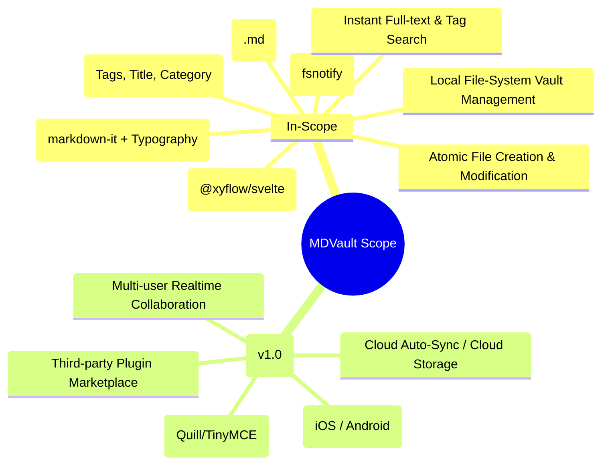
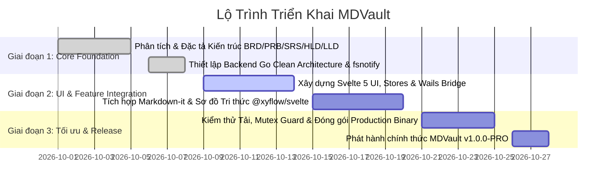

# MDVault - Business Requirements Document (BRD)

> **Mã tài liệu:** BRD-MDVAULT-2026  
> **Dự án:** MDVault (Personal Knowledge Management & Markdown Vault)  
> **Phiên bản:** 1.0.0  
> **Trạng thái:** Approved / Production Baseline  
> **Đối tượng:** Ban Quản Trị Dự Án, Product Owner, Tech Lead, Kỹ Sư Phát Triển  

---

## 1. Tóm Tắt Dự Án (Executive Summary)

**MDVault** là giải pháp phần mềm quản lý ghi chú cá nhân và mạng lưới tri thức cục bộ (Personal Knowledge Management - PKM) thế hệ mới trên nền tảng Desktop. 

Trong bối cảnh người dùng ngày càng lo ngại về quyền riêng tư dữ liệu đám mây (Cloud Privacy), nguy cơ rò rỉ dữ liệu và sự cồng kềnh quá mức của các ứng dụng ghi chú xây dựng trên nền tảng Electron (như Obsidian, Notion desktop, Logseq - thường tiêu tốn 300MB - 1GB RAM ngay cả ở trạng thái chờ), **MDVault** định hình một tiêu chuẩn mới: **Local-First, Zero-Bloat, và Hiệu Năng Cực Đại**. 

Bằng cách tận dụng sức mạnh biên dịch nhị phân trực tiếp của **Go (Wails v2)** kết hợp với engine trình duyệt gốc của hệ điều hành và giao diện phản ứng siêu tốc **Svelte 5**, MDVault mang lại trải nghiệm ghi chú tức thời, bảo mật tuyệt đối và chỉ tiêu thụ một phần nhỏ tài nguyên phần cứng (dưới 50MB RAM).

---

## 2. Bối Cảnh & Vấn Đề Kinh Doanh (Business Context & Problem Statement)

### 2.1. Thực trạng & Vấn đề tồn tại
1. **Khủng hoảng bộ nhớ (RAM Bloat):** Đa phần các ứng dụng ghi chú hiện nay sử dụng Electron - về bản chất là đóng gói nguyên một trình duyệt Chromium và Node.js runtime cho mỗi cửa sổ ứng dụng. Điều này khiến máy tính bị chậm chạp, giảm thời lượng pin của laptop và gây ức chế cho lập trình viên/chuyên gia tri thức khi mở song song cùng IDE nặng.
2. **Nguy cơ rủi ro dữ liệu đám mây (Cloud Lock-in & Privacy Concerns):** Các nền tảng SaaS (như Notion) lưu trữ toàn bộ dữ liệu ghi chú trên server của bên thứ ba, tiềm ẩn rủi ro lộ bí mật kinh doanh, mã nguồn độc quyền, và hoàn toàn tê liệt khi mất kết nối mạng.
3. **Định dạng dữ liệu đóng / Phụ thuộc độc quyền:** Nhiều ứng dụng lưu dữ liệu dưới dạng cơ sở dữ liệu riêng biệt (proprietary database), gây khó khăn khi người dùng muốn sao lưu, di chuyển (migrate) hoặc chỉnh sửa bằng các công cụ dòng lệnh (Vim, VS Code, Git).
4. **Độ trễ đồng bộ file ngoại vi:** Các phần mềm ghi chú truyền thống thường xử lý việc đồng bộ thay đổi file từ bên ngoài bằng cơ chế Polling (quét chu kỳ) gây giật lag hoặc yêu cầu người dùng phải bấm "Reload" thủ công.

### 2.2. Cơ hội kinh doanh & Giá trị mang lại
- Cung cấp một ứng dụng ghi chú miễn phí, mã nguồn mở, độc lập, đạt chuẩn công nghiệp cho cộng đồng kỹ sư, nhà nghiên cứu và người dùng đề cao sự tối giản.
- Khẳng định tính khả thi vượt trội của kiến trúc **Go + Wails + Svelte** thay thế hoàn toàn Electron trong phân khúc Desktop Productivity Tooling.

---

## 3. Mục Tiêu Dự Án (Business Objectives & Success Criteria)

### 3.1. Mục tiêu định lượng (Quantitative Goals)
- **Kích thước bộ cài (Binary Size):** File thực thi độc lập (`mdvault.exe`) $\le$ 25MB (sau khi nén/strip symbol).
- **Mức tiêu hao bộ nhớ (RAM Footprint):** $\le$ 50MB RAM ở trạng thái tĩnh; không vượt quá 120MB khi xử lý kho dữ liệu 10.000 file markdown.
- **Thời gian khởi động (Startup Time):** Khởi chạy giao diện sẵn sàng thao tác trong dưới 300ms (Cold Start).
- **Thời gian phản ứng tệp ngoại vi (Realtime Latency):** Nhận diện và cập nhật thay đổi file từ bên ngoài trong vòng dưới 20ms nhờ cơ chế Event-driven Kernel Watcher.

### 3.2. Mục tiêu định tính (Qualitative Goals)
- **100% Local-First:** Toàn bộ dữ liệu nằm trên ổ đĩa của người dùng dưới định dạng tệp chuẩn `.md` kết hợp Frontmatter YAML. Không bắt buộc tài khoản, không telemetry, không gửi dữ liệu ra ngoài Internet.
- **Độc lập và Tương thích:** Người dùng có thể dùng đồng thời Git, VS Code, Obsidian để chỉnh sửa cùng một thư mục mà không gây xung đột định dạng.
- **Trải nghiệm mượt mà:** Giao diện tối giản, hiện đại, hỗ trợ Dark/Light theme, hiển thị Markdown đẹp mắt và trực quan hóa liên kết tri thức dạng Knowledge Graph.

---

## 4. Phạm Vi Dự Án (Project Scope)

### 4.1. Trong phạm vi (In-Scope)
- Quản lý Workspace ghi chú từ bất kỳ thư mục nào trên máy cục bộ.
- Quét đệ quy cây thư mục và phân tích Frontmatter YAML chuẩn hóa.
- Tự động đồng bộ thời gian thực theo sự kiện của hệ điều hành (không cần quét thủ công).
- Xem trước (Preview) Markdown định dạng chuẩn, hỗ trợ code blocks, tables, math, task lists.
- Trình biên tập ghi chú nhanh (Fast Editor) hỗ trợ lưu nguyên tử (Atomic File Write).
- Trực quan hóa mạng lưới liên kết Wiki-link (`[[Link]]`) thông qua đồ thị tri thức tương tác 2D.
- Bộ lọc và tìm kiếm toàn văn (Full-Text Search) siêu tốc trong bộ nhớ.
- Đóng gói ứng dụng chạy độc lập cho Windows (sẵn sàng mở rộng sang macOS và Linux).

### 4.2. Ngoài phạm vi (Out-of-Scope - Phiên bản hiện tại)
- Đồng bộ hóa đám mây riêng (Cloud Sync Server). *(Khuyến khích người dùng tự đồng bộ qua Git, Google Drive, Syncthing hoặc OneDrive)*.
- Hợp tác thời gian thực giữa nhiều người dùng qua mạng (P2P/CRDT Collaboration).
- Phiên bản trên thiết bị di động (Mobile App).
- Trình chỉnh sửa văn bản dạng khối phức tạp WYSIWYG kéo thả (Block-based like Notion).
- Hệ sinh thái chợ ứng dụng plugin của bên thứ ba (Plugin Marketplace).

---

## 5. Đối Tượng Người Dùng & Các Bên Liên Quan (Stakeholders & Personas)

| Nhóm Đối Tượng | Mô tả đặc điểm | Nhu cầu cốt lõi đối với MDVault |
| :--- | :--- | :--- |
| **Lập trình viên / DevOps** | Làm việc liên tục trên IDE, terminal, quản lý tài liệu kỹ thuật, snippet code | Yêu cầu app cực nhẹ, không ngốn RAM, có thể vừa gõ bằng Vim/VS Code vừa xem trên MDVault |
| **Nhà nghiên cứu / Sinh viên** | Đọc tài liệu, ghi chép luận văn, nghiên cứu liên ngành | Cần tổ chức ghi chú theo chủ đề, tag, và xem sơ đồ liên kết tri thức (Knowledge Graph) |
| **Người dùng chú trọng Bảo mật (Privacy Advocates)** | Không tin tưởng lưu trữ ghi chú cá nhân lên cloud của các công ty công nghệ lớn | Tuyệt đối offline, dữ liệu là các file `.md` phẳng, không mã hóa độc quyền |
| **Product & Tech Team** | Đội ngũ phát triển và bảo trì phần mềm | Kiến trúc sạch (Clean Architecture), dễ mở rộng module, bảo trì lâu dài |

---

## 6. Phân Tích Ma Trận Cạnh Tranh (Competitive Analysis)

| Tiêu chí Đánh giá | MDVault (Go + Svelte 5) | Obsidian | Notion | Logseq |
| :--- | :---: | :---: | :---: | :---: |
| **Mức tiêu hao RAM (Idle)** | **~35 - 50 MB** | 250 - 450 MB | 400 - 800 MB | 350 - 600 MB |
| **Mô hình Dữ liệu** | **100% Local-First (.md)** | Local-First (.md) | Cloud-Only (Proprietary) | Local-First (.md/.org) |
| **Tốc độ Khởi động** | **< 300 ms** | 1.5 - 3.5 s | 3.0 - 6.0 s | 2.5 - 5.0 s |
| **Khả năng Chỉnh sửa Ngoại vi** | **Thời gian thực (<20ms)** | Có độ trễ quét | Không hỗ trợ | Có độ trễ quét |
| **Dung lượng File thực thi** | **~15 - 20 MB** | ~120 MB | ~150 MB | ~180 MB |
| **Phụ thuộc Nền tảng** | **Native WebView (Wails)** | Electron | Electron | Electron |
| **Chi phí / Bản quyền** | **Mã nguồn mở / Miễn phí** | Miễn phí cá nhân / Trả phí Sync | Trả phí theo gói | Mã nguồn mở |

---

## 7. Rủi Ro Kinh Doanh & Chiến Lược Giảm Thiểu (Risks & Mitigations)

1. **Rủi ro phụ thuộc vào WebView của Hệ điều hành:**
   - *Nguy cơ:* Trên các máy Windows đời cũ thiếu WebView2 Runtime, ứng dụng có thể không hiển thị được giao diện.
   - *Biện pháp:* Wails v2 tự động kiểm tra và tích hợp bộ kích hoạt cài đặt WebView2 chính chủ từ Microsoft khi phát hiện thiếu hụt.
2. **Rủi ro xung đột ghi đè dữ liệu (File Concurrency):**
   - *Nguy cơ:* Người dùng đồng thời sửa file trên VS Code và trên MDVault cùng một giây.
   - *Biện pháp:* Thiết lập cơ chế khóa luồng `sync.Mutex` tại tầng Repository của Go và kỹ thuật ghi file nguyên tử (Atomic Write via Temp File rename).
3. **Rủi ro khả năng mở rộng với kho dữ liệu khổng lồ (>50.000 tệp):**
   - *Nguy cơ:* Quét đệ quy và render đồ thị quá nhiều nút gây nghẽn UI.
   - *Biện pháp:* Bộ nhớ đệm phân tầng (In-Memory Cache), phân trang hiển thị và áp dụng thuật toán cắt nhánh (culling) trong đồ thị.

---

## 8. Lộ Trình Phát Triển & Kế Hoạch Bàn Giao (Release Roadmap)

