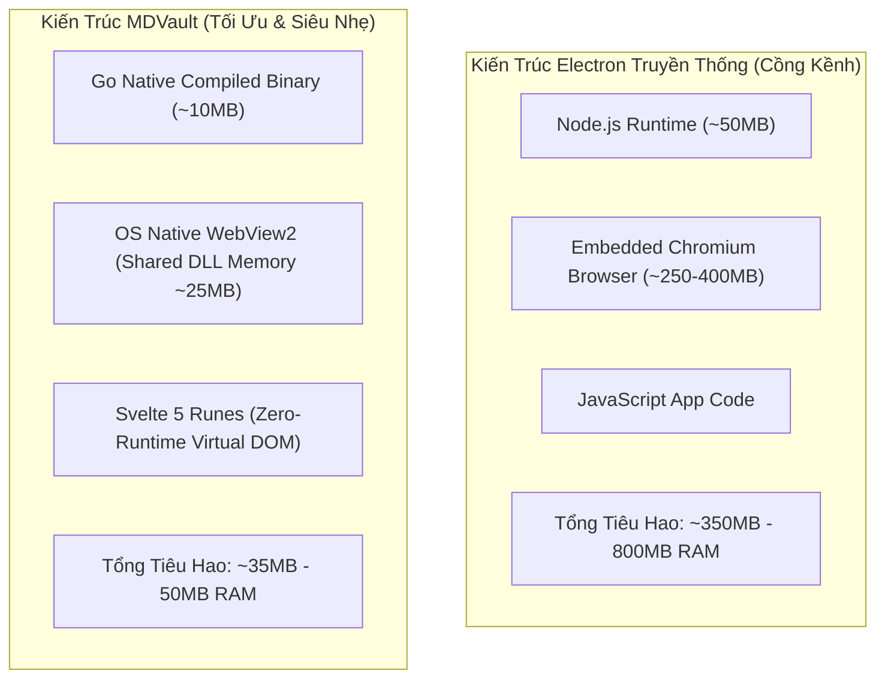
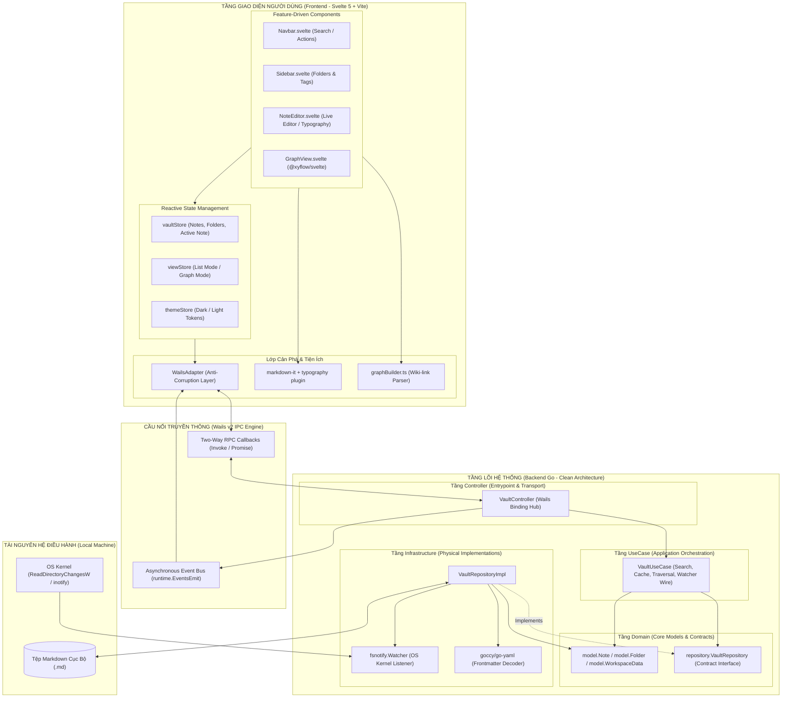
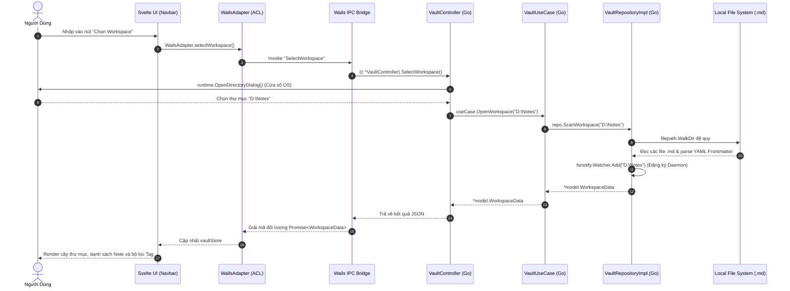
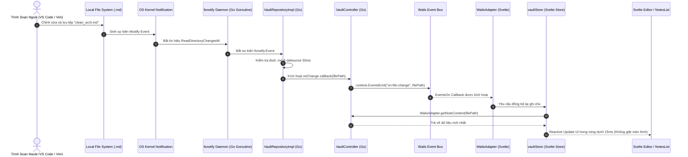
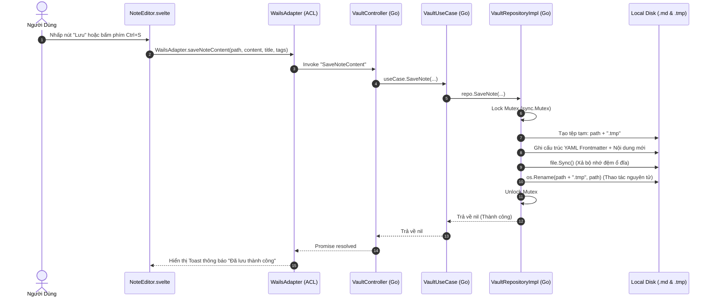

# MDVault - High-Level Design (HLD) & System Architecture Specification

> **Mã tài liệu:** HLD-MDVAULT-ARCH-2026  
> **Dự án:** MDVault - Professional Desktop Markdown Vault  
> **Phiên bản:** 2.0.0-PRO (Industrial Standard)  
> **Trạng thái:** Approved Architecture  
> **Kiến trúc cốt lõi:** Clean Architecture (Go) + Feature-Driven Design Modular SPA (Svelte 5)  

---

## 1. Tầm Nhìn Kiến Trúc & Triết Lý Thiết Kế (Architectural Vision & Principles)

**MDVault** được định hình dựa trên triết lý **Local-First, Lightweight & Zero-Bloat** (Tự chủ dữ liệu cục bộ, Siêu nhẹ và Không cồng kềnh). 

Để khắc phục hoàn toàn điểm yếu tiêu tốn tài nguyên khổng lồ của các phần mềm xây dựng trên nền tảng Chromium/Electron (thường ngốn 300MB - 800MB RAM chỉ để đọc file tĩnh), MDVault tận dụng sức mạnh biên dịch nhị phân trực tiếp của **Go 1.22+** kết hợp với WebView gốc của hệ điều hành (Microsoft Edge WebView2 trên Windows / WebKit trên macOS/Linux) thông qua framework **Wails v2**.



### Các nguyên tắc kiến trúc chủ đạo:
1. **Dependency Inversion Principle (DIP):** Lớp bên ngoài phụ thuộc vào lớp bên trong. Logic nghiệp vụ (Domain & UseCase) hoàn toàn độc lập với chi tiết kỹ thuật (FileSystem, OS Dialog, Wails IPC).
2. **Anti-Corruption Layer (ACL):** Giao diện Frontend Svelte không phụ thuộc trực tiếp vào các hàm sinh tự động RPC của Wails. Lớp chuyển đổi `WailsAdapter` đứng ở giữa chịu trách nhiệm chuẩn hóa dữ liệu và xử lý bắt lỗi.
3. **Event-Driven Kernel Observation:** Giám sát tệp tin dựa trên sự kiện vi mô từ nhân hệ điều hành (OS Kernel Signals) qua `fsnotify`, loại bỏ hoàn toàn cơ chế Polling tốn CPU.
4. **Atomic Concurrency & Thread Safety:** Đảm bảo toàn vẹn dữ liệu khi đọc/ghi đồng thời bằng khóa độc quyền `sync.Mutex` và cơ chế ghi tệp tạm trước khi hoán đổi (Atomic Rename).

---

## 2. Bản Đồ Kiến Trúc Hệ Thống Tổng Thể (System Architecture Blueprint)



---

## 3. Kiến Trúc Phân Lớp Backend Go (Clean Architecture Decomposition)

Backend Go được tổ chức tuân thủ nghiêm ngặt nguyên lý 4 phân lớp của Clean Architecture:

```
d:\Tu-hoc\project\MDVault/
├── domain/                    # TẦNG 1: NHÂN DOANH NGHIỆP (INMOST LAYER)
│   ├── model/                 # Các thực thể cốt lõi (Note, Folder, WorkspaceData, Frontmatter)
│   └── repository/            # Giao diện hợp đồng (VaultRepository Contract Interface)
│
├── usecase/                   # TẦNG 2: NGHIỆP VỤ ỨNG DỤNG (APPLICATION ORCHESTRATION)
│   └── vault_usecase.go       # Triển khai thuật toán điều hướng, bộ nhớ đệm và tìm kiếm
│
├── infrastructure/            # TẦNG 3: TRIỂN KHAI NGOẠI VI (INFRASTRUCTURE ADAPTERS)
│   └── filesystem/            # Triển khai VaultRepository bằng `os`, `fsnotify`, `goccy/go-yaml`
│
├── controller/                # TẦNG 4: ĐIỂM TIẾP LỰC NGOÀI (TRANSPORT & WAILS CONTROLLER)
│   └── vault_controller.go    # Quản lý sự kiện Wails, chuyển hóa lỗi và gọi OS Dialog
│
└── main.go                    # ENTRY POINT & DEPENDENCY INJECTION ROOT
```

### 3.1. Tầng Domain (`domain/`)
- Chứa các kiểu dữ liệu thực thể thuần túy của hệ thống, không import bất kỳ package ngoại vi nào ngoài thư viện chuẩn.
- Định nghĩa interface `VaultRepository`:
  - `ScanWorkspace(dirPath string) (*model.WorkspaceData, error)`
  - `GetNote(filePath string) (*model.Note, error)`
  - `SaveNote(filePath string, content string, title string, tags []string) error`
  - `CreateFolder(parentPath string, name string) error`
  - `CreateNote(folderPath string, title string) (*model.Note, error)`
  - `StartWatching(dirPath string, onChange func(path string)) error`
  - `StopWatching() error`

### 3.2. Tầng UseCase (`usecase/`)
- Đảm nhận vai trò phối hợp logic nghiệp vụ:
  - Duy trì bộ nhớ đệm an toàn đồng thời cho workspace đang hoạt động (`currentWsPath`, `currentData`).
  - Cung cấp thuật toán tìm kiếm đa tiêu chí `SearchNotes(query string)` trên tập hợp ghi chú đã được nạp sẵn trong bộ nhớ.
  - Tiếp nhận callback từ Repository và phân phối tín hiệu tới tầng Controller.

### 3.3. Tầng Infrastructure (`infrastructure/filesystem/`)
- Triển khai interface `VaultRepository`:
  - Thuật toán duyệt đệ quy `filepath.WalkDir` tối ưu, chỉ thu thập file `.md`.
  - Bộ giải mã siêu dữ liệu `goccy/go-yaml` bóc tách Frontmatter trong thời gian micro-giây.
  - Module giám sát `fsnotify.Watcher` chạy trên Goroutine nền độc lập để bắt sự kiện từ OS Kernel.
  - Sử dụng cơ chế khóa độc quyền `sync.Mutex` bao bọc mọi thao tác I/O.

### 3.4. Tầng Controller (`controller/`)
- Đóng vai trò là Wails IPC Controller, tiếp nhận trực tiếp các yêu cầu từ giao diện frontend.
- Kích hoạt cửa sổ hộp thoại hệ thống `runtime.OpenDirectoryDialog`.
- Phát các tín hiệu thời gian thực `runtime.EventsEmit(ctx, "on-file-change", filePath)`.

---

## 4. Kiến Trúc Frontend Modular & Feature-Driven (Svelte 5)

Frontend áp dụng kiến trúc **Feature-Driven Design (FDD)**, cấu trúc theo từng nhóm tính năng độc lập nhằm tối đa hóa khả năng bảo trì và tái sử dụng:

```
frontend/src/
├── assets/                    # Styling Tokens & Css Architecture
│   ├── index.css              # Custom tokens
│   └── app.css                # @import "tailwindcss" (Tailwind v4) & Typography
├── lib/
│   ├── types/
│   │   └── domain.ts          # TypeScript Interfaces ánh xạ 1-1 với Go Structs
│   ├── stores/                # QUẢN TRỊ TRẠNG THÁI PHẢN ỨNG (REACTIVE STORES)
│   │   ├── vaultStore.ts      # Quản lý Cây Thư Mục, Danh Sách Notes, Active Note, Filter Tags
│   │   ├── viewStore.ts       # Chuyển đổi ngữ cảnh hiển thị (Chế độ Danh sách <=> Đồ thị Graph)
│   │   └── themeStore.ts      # Trình quản lý Theme Dark / Light theo Realtime Token
│   ├── wails/
│   │   └── wailsAdapter.ts    # LỚP CẢN PHÁ IPC (Anti-Corruption Layer)
│   └── utils/
│       ├── markdown.ts        # Pipeline render Markdown siêu tốc với markdown-it
│       └── graphBuilder.ts    # Bộ giải mã [[Wiki-link]] sinh cấu trúc node/edge cho @xyflow/svelte
├── components/                # FEATURE MODULES
│   ├── layout/Navbar.svelte   # Thanh điều khiển đa nhiệm, ô tìm kiếm và kích hoạt Workspace
│   ├── sidebar/               # Quản trị không gian lưu trữ
│   │   ├── Sidebar.svelte     # Bảng điều khiển phân nhóm & bộ lọc Tag pills
│   │   └── FolderTreeItem.svelte # Đệ quy hiển thị Thư mục phân cấp của Svelte 5
│   ├── note/                  # Không gian tương tác văn bản
│   │   ├── NotesList.svelte   # Khung cảm biến tóm tắt và danh sách ghi chú dạng thẻ/danh sách
│   │   └── NoteEditor.svelte  # Trình soạn thảo văn bản hỗ trợ Live Preview & Markdown Typography
│   └── graph/                 # Đồ thị Tri thức trực quan
│       └── GraphView.svelte   # Canvas đồ thị tương tác 2D (@xyflow/svelte)
├── App.svelte                 # Master Component, Khởi tạo Lifecycle & Lắng nghe sự kiện IPC
└── main.ts                    # Điểm nạp ứng dụng Svelte
```

---

## 5. Các Luồng Thực Thi Trọng Yếu (End-to-End Sequence Workflows)

### 5.1. Luồng Khởi Động & Nạp Thư Mục Workspace



### 5.2. Luồng Phản Ứng Sự Kiện Tệp Ngoại Vi (Realtime Watcher Trigger)



### 5.3. Luồng Lưu Ghi Chú Nguyên Tử (Atomic Persistence Flow)



---

## 6. Xử Lý Các Mối Quan Tâm Xuyên Suốt (Cross-Cutting Concerns)

### 6.1. Kiểm Soát An Toàn Đồng Thời (Concurrency Guards)
- Mọi tài nguyên chia sẻ bao gồm: đường dẫn Workspace hiện tại (`currentWsPath`), bộ nhớ đệm tệp, và danh sách các thư mục đang được đăng ký với `fsnotify` đều được bảo vệ bằng con trỏ khóa `sync.Mutex`.
- Tránh deadlock bằng cách chỉ khóa Mutex trong phạm vi hẹp nhất của thao tác I/O hoặc truy xuất mảng, tuyệt đối không giữ khóa qua các tác vụ gọi network hoặc dialog hệ thống.

### 6.2. Kiểm Soát Lỗi Tập Trung (Centralized Error Strategy)
- Tầng Infrastructure bọc mọi lỗi I/O của hệ điều hành vào thông báo có ý nghĩa.
- Tầng Controller chuyển đổi `error` của Go thành chuỗi thông điệp rõ ràng trước khi trả về qua RPC Wails.
- Tầng Frontend `WailsAdapter` bắt lỗi trong khối `try-catch`, cung cấp cơ chế dự phòng an toàn (Fallback Gracefully) giúp ứng dụng không bao giờ bị đứng hình hay mất dữ liệu đang soạn thảo.

### 6.3. Tối Ưu Hóa Bộ Nhớ & Tốc Độ Render Đồ Thị
- Thuật toán trích xuất Wiki-link chỉ chạy trên tập ghi chú đã nạp vào bộ nhớ.
- Đồ thị `@xyflow/svelte` áp dụng kỹ thuật tính toán tọa độ Euclid phân bổ đồng tâm (Concentric Circle Distribution), đảm bảo khả năng hiển thị mượt mà 60 FPS ngay cả khi có hàng trăm nút liên kết.
