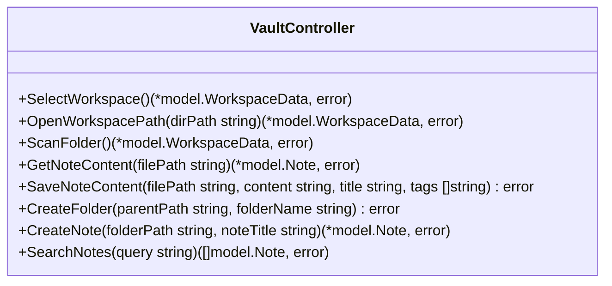

# MDVault - Low-Level Design (LLD) & API Specification

> **Mã tài liệu:** LLD-MDVAULT-SPEC-2026  
> **Dự án:** MDVault - Desktop Markdown Vault & Knowledge Graph  
> **Phiên bản:** 2.0.0-PRO  
> **Trạng thái:** Approved Specification  
> **Trọng tâm kỹ thuật:** Go Backend Structs/Interfaces, Svelte 5 Stores, & Wails IPC API Contracts  

---

## 1. Mô Hình Dữ Liệu Chi Tiết (Data Models & Structs)

Toàn bộ mô hình dữ liệu lõi được khai báo tại package `domain/model` của Backend Go và được ánh xạ tương thích 1-1 với TypeScript trong `frontend/src/lib/types/domain.ts`.

### 1.1. Cấu Trúc Backend (Go Structs)

```go
package model

// Note đại diện cho cấu trúc 1 file markdown trong Domain
type Note struct {
	ID           string   `json:"id"`           // Đường dẫn file chuẩn hóa tuyệt đối
	Title        string   `json:"title"`        // Tiêu đề trích xuất từ Frontmatter / Heading 1
	Content      string   `json:"content"`      // Nội dung văn bản Markdown thuần túy
	Tags         []string `json:"tags"`         // Danh sách các thẻ phân loại từ Frontmatter
	Folder       string   `json:"folder"`       // Đường dẫn thư mục cha trực tiếp
	LastModified string   `json:"lastModified"` // Thời điểm sửa đổi gần nhất (RFC3339 ISO String)
	Excerpt      string   `json:"excerpt"`      // Đoạn trích tóm tắt (tối đa 150 ký tự đầu)
}

// Folder đại diện cho thư mục lưu trữ trong cây Workspace phân cấp
type Folder struct {
	ID       string    `json:"id"`                 // Đường dẫn thư mục chuẩn hóa
	Name     string    `json:"name"`               // Tên hiển thị của thư mục
	Icon     string    `json:"icon"`               // Mã định danh biểu tượng giao diện
	Children []*Folder `json:"children,omitempty"` // Danh sách các thư mục con đệ quy
	Level    int       `json:"level"`              // Độ sâu phân cấp trong cây (bắt đầu từ 0)
	Type     string    `json:"type,omitempty"`     // Phân loại: "folder" | "category"
}

// WorkspaceData lưu trữ toàn bộ thông tin hệ thống tệp ghi chú được nạp vào bộ nhớ
type WorkspaceData struct {
	RootPath string    `json:"rootPath"` // Đường dẫn thư mục gốc đang được giám sát
	Folders  []*Folder `json:"folders"`  // Cây thư mục hoàn chỉnh
	Notes    []Note    `json:"notes"`    // Danh sách phẳng tất cả các ghi chú trong workspace
	AllTags  []string  `json:"allTags"`  // Danh sách các thẻ duy nhất (Unique Tags Set)
}

// Frontmatter mô tả cấu trúc YAML đặt tại đầu file markdown
type Frontmatter struct {
	Title string   `yaml:"title"`          // Tiêu đề ghi chú khai báo trong YAML
	Tags  []string `yaml:"tags"`           // Danh sách thẻ gắn kèm
	Icon  string   `yaml:"icon,omitempty"` // Biểu tượng tùy biến (tùy chọn)
}
```

### 1.2. Cấu Trúc Frontend (TypeScript Type Definitions)

```typescript
// frontend/src/lib/types/domain.ts
export interface Note {
  id: string;
  title: string;
  content: string;
  tags: string[];
  folder: string;
  lastModified: string;
  excerpt: string;
}

export interface Folder {
  id: string;
  name: string;
  icon: string;
  children?: Folder[];
  level: number;
  type?: string;
}

export interface WorkspaceData {
  rootPath: string;
  folders: Folder[];
  notes: Note[];
  allTags: string[];
}
```

---

## 2. Thiết Kế Chi Tiết Tầng Backend (Go Low-Level Implementation)

### 2.1. Hợp Đồng Tầng Repository (`domain/repository/vault_repository.go`)

```go
package repository

import "mdvault/domain/model"

type VaultRepository interface {
	// Quét đệ quy thư mục và bóc tách cấu trúc tệp .md
	ScanWorkspace(dirPath string) (*model.WorkspaceData, error)
	// Đọc nội dung chi tiết của một tệp ghi chú
	GetNote(filePath string) (*model.Note, error)
	// Lưu nội dung ghi chú xuống ổ cứng theo cơ chế nguyên tử (Atomic Write)
	SaveNote(filePath string, content string, title string, tags []string) error
	// Tạo thư mục mới trên hệ thống tệp
	CreateFolder(parentPath string, name string) error
	// Tạo tệp ghi chú mới kèm YAML Frontmatter mẫu
	CreateNote(folderPath string, title string) (*model.Note, error)
	// Khởi chạy Daemon giám sát biến động hệ thống tệp thời gian thực
	StartWatching(dirPath string, onChange func(path string)) error
	// Hủy đăng ký và dừng Daemon giám sát
	StopWatching() error
}
```

### 2.2. Chi Tiết Triển Khai Repository (`infrastructure/filesystem/vault_repository_impl.go`)

1. **Thuật toán quét cây thư mục đệ quy:**
   - Sử dụng `filepath.WalkDir` để đạt tốc độ tối đa và giảm thiểu số lần gọi system call `lstat`.
   - Bỏ qua các thư mục ẩn bắt đầu bằng dấu chấm (như `.git`, `.vscode`).
   - Lọc các tệp có phần mở rộng `.md` hoặc `.markdown`.
2. **Bộ giải mã Frontmatter:**
   - Tìm kiếm dòng phân cách `---` đầu tiên và thứ hai.
   - Trích xuất khối YAML nằm giữa hai dòng phân cách và giải mã bằng `goccy/go-yaml`.
   - Nếu giải mã thành công nhưng thiếu `Title`, tự động trích xuất từ Heading 1 (`strings.HasPrefix(line, "# ")`).
3. **Module giám sát `fsnotify.Watcher`:**
   - Chạy một Goroutine nền thường trực lắng nghe trên channel `watcher.Events`.
   - Bắt các sự kiện `fsnotify.Write`, `fsnotify.Create`, `fsnotify.Remove`, `fsnotify.Rename`.
   - Triển khai cơ chế debounce 50ms nhằm gộp các sự kiện trùng lặp do hệ điều hành phát ra liên tiếp khi ghi file.
4. **Cơ chế ghi file nguyên tử (Atomic File Persistence):**
   - Viết toàn bộ nội dung mới vào một tệp tạm: `tempPath := filePath + ".tmp"`.
   - Gọi hàm `file.Sync()` để ép dữ liệu từ bộ nhớ đệm hệ điều hành xả hoàn toàn xuống đĩa cứng.
   - Thực hiện lệnh `os.Rename(tempPath, filePath)` – thao tác hoán đổi tên tệp là nguyên tử (Atomic) ở cấp độ hệ thống tệp NTFS/ext4, loại bỏ nguy cơ tệp bị hỏng hoặc mất dữ liệu khi mất điện đột ngột.

### 2.3. Chi Tiết Tầng Nghiệp Vụ (`usecase/vault_usecase.go`)

1. **Bảo vệ an toàn đa luồng (Thread-Safe Mutex):**
   - Sử dụng `sync.Mutex` để bao bọc các biến toàn cục trong UseCase: `currentWsPath`, `currentData`, `onChangeCb`.
2. **Thuật toán tìm kiếm trong bộ nhớ (In-Memory Search Algorithm):**
   - Độ phức tạp thời gian: $O(N)$ với $N$ là tổng số ghi chú trong Workspace.
   - Chuẩn hóa từ khóa tìm kiếm về chữ thường: `q := strings.ToLower(strings.TrimSpace(query))`.
   - Khớp nối đa trường: Kiểm tra chuỗi con đồng thời trên `strings.Contains(strings.ToLower(note.Title), q)`, trên từng phần tử của `note.Tags`, và trên `strings.Contains(strings.ToLower(note.Content), q)`.

---

## 3. Đặc Tả Chi Tiết Bộ API Giao Tiếp Wails IPC (IPC API Specifications)

Toàn bộ các phương thức dưới đây được công khai (exposed) từ `VaultController` của Go tới Frontend JavaScript/TypeScript qua cơ chế gọi hàm Wails Binding.



---

### API-01: `SelectWorkspace()`
- **Mục đích:** Kích hoạt hộp thoại mở thư mục gốc của hệ điều hành, quét nội dung và thiết lập hệ thống giám sát.
- **Phương thức gọi:** `window.go.controller.VaultController.SelectWorkspace()`
- **Tham số đầu vào:** Không có (`void`).
- **Phản hồi thành công (Success Response):**
  - **Kiểu dữ liệu:** `model.WorkspaceData`
  - **Schema JSON:**
```json
{
  "rootPath": "D:\\Tu-hoc\\project\\MDVault\\markdown",
  "folders": [
    {
      "id": "D:\\Tu-hoc\\project\\MDVault\\markdown",
      "name": "markdown",
      "icon": "folder",
      "children": [],
      "level": 0
    }
  ],
  "notes": [
    {
      "id": "D:\\Tu-hoc\\project\\MDVault\\markdown\\BRD.md",
      "title": "Tài Liệu Yêu Cầu Nghiệp Vụ (BRD) - MDVault",
      "content": "...",
      "tags": ["documentation", "requirements", "brd"],
      "folder": "D:\\Tu-hoc\\project\\MDVault\\markdown",
      "lastModified": "2026-10-10T11:45:00Z",
      "excerpt": "MDVault là giải pháp phần mềm quản lý ghi chú..."
    }
  ],
  "allTags": ["brd", "documentation", "requirements"]
}
```
- **Xử lý ngoại lệ (Error Response):**
  - Trả về đối tượng `Error` với thông điệp `"không có thư mục nào được chọn"` nếu người dùng bấm Hủy (Cancel).

---

### API-02: `OpenWorkspacePath(dirPath)`
- **Mục đích:** Mở trực tiếp một thư mục Workspace theo đường dẫn tuyệt đối mà không cần bật hộp thoại chọn.
- **Phương thức gọi:** `window.go.controller.VaultController.OpenWorkspacePath(dirPath)`
- **Tham số đầu vào:**
  | Tên tham số | Kiểu dữ liệu | Bắt buộc | Mô tả kỹ thuật |
  | :--- | :--- | :---: | :--- |
  | `dirPath` | `string` | Có | Đường dẫn tuyệt đối của thư mục trên ổ đĩa (VD: `"C:\\Users\\User\\Notes"`) |
- **Phản hồi thành công:** Trả về đối tượng `model.WorkspaceData`.
- **Mã lỗi:** Trả về `error` nếu đường dẫn không tồn tại hoặc không phải là thư mục.

---

### API-03: `ScanFolder()`
- **Mục đích:** Quét lại toàn bộ Workspace hiện tại từ bộ nhớ đệm / đĩa và trả về trạng thái mới nhất.
- **Phương thức gọi:** `window.go.controller.VaultController.ScanFolder()`
- **Tham số đầu vào:** Không có.
- **Phản hồi thành công:** Trả về đối tượng `model.WorkspaceData`.
- **Mã lỗi:** Trả về `error` nếu chưa có Workspace nào được mở trước đó.

---

### API-04: `GetNoteContent(filePath)`
- **Mục đích:** Đọc chi tiết nội dung văn bản, tiêu đề và siêu dữ liệu YAML Frontmatter của một ghi chú cụ thể.
- **Phương thức gọi:** `window.go.controller.VaultController.GetNoteContent(filePath)`
- **Tham số đầu vào:**
  | Tên tham số | Kiểu dữ liệu | Bắt buộc | Mô tả kỹ thuật |
  | :--- | :--- | :---: | :--- |
  | `filePath` | `string` | Có | Đường dẫn tuyệt đối tới tệp `.md` |
- **Phản hồi thành công (JSON Example):**
```json
{
  "id": "D:\\Notes\\Architecture.md",
  "title": "Kiến Trúc Clean Architecture",
  "content": "## 1. Giới thiệu...\nNội dung chi tiết...",
  "tags": ["golang", "architecture"],
  "folder": "D:\\Notes",
  "lastModified": "2026-10-10T10:15:30Z",
  "excerpt": "Uncle Bob's pattern phân tách rõ các phân lớp..."
}
```
- **Mã lỗi:** Trả về lỗi nếu file bị xóa hoặc không đủ quyền đọc (Permission Denied).

---

### API-05: `SaveNoteContent(filePath, content, title, tags)`
- **Mục đích:** Lưu ghi chú xuống ổ cứng theo cơ chế nguyên tử (Atomic Write), tự động cấu trúc lại YAML Frontmatter ở đầu file.
- **Phương thức gọi:** `window.go.controller.VaultController.SaveNoteContent(filePath, content, title, tags)`
- **Tham số đầu vào:**
  | Tên tham số | Kiểu dữ liệu | Bắt buộc | Mô tả kỹ thuật |
  | :--- | :--- | :---: | :--- |
  | `filePath` | `string` | Có | Đường dẫn tuyệt đối của tệp `.md` cần ghi |
  | `content` | `string` | Có | Nội dung Markdown mới |
  | `title` | `string` | Có | Tiêu đề ghi chú (sẽ được ghi vào Frontmatter) |
  | `tags` | `string[]` | Có | Mảng các nhãn phân loại (sẽ được ghi vào Frontmatter) |
- **Phản hồi thành công:** `null` / `void` (Promise resolved).
- **Mã lỗi:** Trả về lỗi nếu phân vùng ổ cứng bị khóa hoặc hết dung lượng.

---

### API-06: `CreateFolder(parentPath, folderName)`
- **Mục đích:** Tạo một thư mục con vật lý mới trên hệ thống tệp và tự động đưa vào danh sách giám sát.
- **Phương thức gọi:** `window.go.controller.VaultController.CreateFolder(parentPath, folderName)`
- **Tham số đầu vào:**
  | Tên tham số | Kiểu dữ liệu | Bắt buộc | Mô tả |
  | :--- | :--- | :---: | :--- |
  | `parentPath` | `string` | Có | Đường dẫn thư mục cha |
  | `folderName` | `string` | Có | Tên thư mục mới (không chứa ký tự cấm: `\ / : * ? " < > \|`) |
- **Phản hồi thành công:** `null` / `void`.

---

### API-07: `CreateNote(folderPath, noteTitle)`
- **Mục đích:** Tạo một file `.md` mới với cấu trúc YAML Frontmatter chuẩn (`tags: []`, `# Tiêu đề`).
- **Phương thức gọi:** `window.go.controller.VaultController.CreateNote(folderPath, noteTitle)`
- **Tham số đầu vào:**
  | Tên tham số | Kiểu dữ liệu | Bắt buộc | Mô tả |
  | :--- | :--- | :---: | :--- |
  | `folderPath` | `string` | Có | Đường dẫn thư mục lưu trữ file mới |
  | `noteTitle` | `string` | Có | Tiêu đề của ghi chú |
- **Phản hồi thành công:** Đối tượng `model.Note` đại diện cho file vừa được tạo.

---

### API-08: `SearchNotes(query)`
- **Mục đích:** Tìm kiếm tức thời trong bộ nhớ đệm theo từ khóa trên Tiêu đề, Tags và Nội dung toàn văn.
- **Phương thức gọi:** `window.go.controller.VaultController.SearchNotes(query)`
- **Tham số đầu vào:**
  | Tên tham số | Kiểu dữ liệu | Bắt buộc | Mô tả |
  | :--- | :--- | :---: | :--- |
  | `query` | `string` | Có | Từ khóa tìm kiếm (Case-insensitive) |
- **Phản hồi thành công:** Mảng các đối tượng `[]model.Note` thỏa mãn điều kiện khớp chuỗi.

---

### 3.9. Đặc Tả Sự Kiện Hệ Thống Thời Gian Thực (Runtime Events)

- **Tên sự kiện:** `on-file-change`
- **Giao thức:** Wails Event Bus (`runtime.EventsEmit` $\rightarrow$ `runtime.EventsOn`)
- **Tần suất phát tín hiệu:** Sự kiện hướng dữ liệu (Event-driven) có gắn bộ giới hạn tần số (Debounce 50ms).
- **Cấu trúc dữ liệu Payload:**
  ```typescript
  filePath: string // Đường dẫn tuyệt đối của file hoặc thư mục vừa bị biến động
  ```
- **Hành vi xử lý phía Frontend:**
  ```typescript
  // Trong App.svelte
  wailsAdapter.onFileChange((filePath: string) => {
    // Tự động làm mới dữ liệu mà không làm thay đổi trạng thái cuộn của người dùng
    vaultStore.refreshWorkspace();
  });
  ```

---

## 4. Thiết Kế Chi Tiết Tầng Frontend (Svelte 5 Low-Level Implementation)

### 4.1. Lớp Cản Phá Wails Adapter (`lib/wails/wailsAdapter.ts`)
Lớp `WailsAdapter` đóng vai trò là Anti-Corruption Layer, ngăn không cho các Svelte components gọi trực tiếp module sinh tự động của Wails:

```typescript
export class WailsAdapter {
  async selectWorkspace(): Promise<WorkspaceData> {
    try {
      // @ts-ignore
      return await window.go.controller.VaultController.SelectWorkspace();
    } catch (err) {
      console.error("Lỗi khi mở workspace:", err);
      throw err;
    }
  }

  async getNoteContent(filePath: string): Promise<Note> {
    // @ts-ignore
    return await window.go.controller.VaultController.GetNoteContent(filePath);
  }

  async saveNoteContent(filePath: string, content: string, title: string, tags: string[]): Promise<void> {
    // @ts-ignore
    return await window.go.controller.VaultController.SaveNoteContent(filePath, content, title, tags);
  }

  onFileChange(callback: (path: string) => void): void {
    // @ts-ignore
    if (window.runtime && window.runtime.EventsOn) {
      // @ts-ignore
      window.runtime.EventsOn("on-file-change", callback);
    }
  }
}
```

### 4.2. Cấu Trúc Quản Trị Trạng Thái (`lib/stores/vaultStore.ts`)
`vaultStore` quản lý toàn bộ trạng thái phản ứng của ứng dụng thông qua Svelte Store:
- **`workspace`:** Lưu trữ `WorkspaceData` (danh sách tệp, cây thư mục, tags).
- **`activeNote`:** Ghi chú hiện tại đang được mở trong trình soạn thảo.
- **`searchQuery`:** Từ khóa tìm kiếm đang nhập.
- **`selectedTag`:** Thẻ tag đang được chọn để lọc ghi chú.
- **`selectedFolder`:** Thư mục đang được chọn trên cây phân cấp.
- **Derived Stores:** Tự động tính toán danh sách ghi chú thỏa mãn đồng thời bộ lọc Tag, bộ lọc Folder và từ khóa tìm kiếm (`filteredNotes`).

### 4.3. Thuật Toán Trực Quan Hóa Đồ Thị Tri Thức (`lib/utils/graphBuilder.ts`)
1. **Trích xuất liên kết:**
   - Sử dụng biểu thức chính quy:
     ```javascript
     const WIKI_LINK_REGEX = /\[\[(.*?)\]\]/g;
     ```
   - Quét qua nội dung của từng Note trong `workspace.notes`.
2. **Khởi tạo Nodes và Edges:**
   - Mỗi ghi chú được cấp một Node:
     ```javascript
     { id: note.id, data: { label: note.title }, position: { x, y } }
     ```
   - Tọa độ `(x, y)` được tính toán theo thuật toán Phân bổ Hướng tâm (Radial Distribution) quanh tâm đồ thị:
     $$x = R \cdot \cos\left(\frac{2\pi \cdot i}{N}\right), \quad y = R \cdot \sin\left(\frac{2\pi \cdot i}{N}\right)$$
   - Nếu tìm thấy `[[TargetTitle]]` trùng khớp với tiêu đề của một Note khác trong workspace, tạo một Edge:
     ```javascript
     { id: `${source.id}->${target.id}`, source: source.id, target: target.id, animated: true }
     ```

---

## 5. Ma Trận Xử Lý Lỗi & Ngoại Lệ (Error Handling Matrix)

| Kịch Bản Lỗi | Mã / Dấu Hiệu Nhận Biết | Nguyên Nhân Kỹ Thuật | Phương Án Xử Lý Hệ Thống |
| :--- | :--- | :--- | :--- |
| **Hủy chọn thư mục** | `"không có thư mục nào được chọn"` | Người dùng bấm Esc hoặc Cancel trong cửa sổ OS | Bỏ qua nhẹ nhàng, giữ nguyên trạng thái workspace cũ |
| **Đường dẫn không hợp lệ** | `ERR_PATH_NOT_FOUND` | Thư mục bị di chuyển hoặc đổi tên từ ngoài OS | Hiển thị Toast cảnh báo, đề xuất chọn lại Workspace |
| **Xung đột ghi đè tệp** | `os.ErrPermission` / `Sharing violation` | File đang bị khóa bởi trình quét virus hoặc IDE khác | Bắt lỗi tại Repository, trả về thông báo để người dùng thử lại |
| **YAML Frontmatter sai cú pháp** | `yaml: unmarshal errors` | Người dùng gõ sai cú pháp thụt dòng trong file `.md` | Bỏ qua Frontmatter bị hỏng, fallback lấy tiêu đề theo Heading 1/Tên tệp |
| **File Watcher bị giới hạn file** | `too many open files` | Workspace chứa quá nhiều thư mục con sâu | Đóng các watcher thư mục rỗng, chỉ theo dõi các thư mục con chứa file `.md` |
