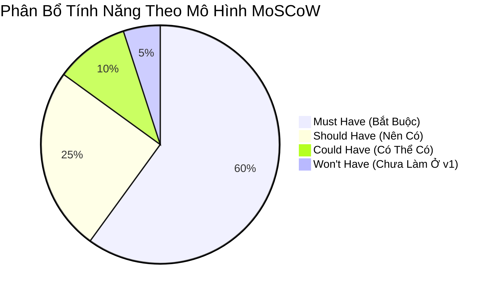

# MDVault - Product Requirements Brief (PRB / PRD)

> **Mã tài liệu:** PRB-MDVAULT-2026  
> **Sản phẩm:** MDVault Desktop Application  
> **Phiên bản:** 1.0.0-PRO  
> **Trạng thái:** Baseline Approved  
> **Chịu trách nhiệm sản phẩm:** Product Management & Engineering Team  

---

## 1. Tầm Nhìn Sản Phẩm & Giá Trị Cốt Lõi (Product Vision & Value Proposition)

### 1.1. Tuyên ngôn sản phẩm
> *"Đối với những chuyên gia tri thức, lập trình viên và nhà nghiên cứu cần một không gian ghi chú tập trung và an toàn, **MDVault** là ứng dụng desktop quản lý Markdown cục bộ thế hệ mới mang lại tốc độ tức thời và khả năng trực quan hóa mạng lưới tri thức mà không làm tiêu hao tài nguyên máy tính như các ứng dụng Electron cồng kềnh."*

### 1.2. Ba trụ cột sản phẩm (Three Product Pillars)
1. **Tốc độ & Gọn nhẹ (Ultra-Fast & Zero-Bloat):** Khởi động dưới 300ms, tiêu thụ dưới 50MB RAM, không giật lag ngay cả khi kho lưu trữ có hàng nghìn ghi chú.
2. **Tự chủ dữ liệu (100% Data Sovereignty):** Hoạt động hoàn toàn Offline, lưu trữ trên hệ thống tệp cục bộ dạng `.md` thuần túy kèm YAML Frontmatter, tương thích 100% với các công cụ bên ngoài (Git, Vim, VS Code).
3. **Mạng lưới tri thức sống động (Dynamic Knowledge Network):** Tự động liên kết các ghi chú thông qua cú pháp `[[Wiki-link]]` và biến chúng thành Đồ thị Tri thức (Interactive Knowledge Graph) trực quan.

---

## 2. Chân Dung Người Dùng (User Personas)

### Persona 1: Alex - Lập Trình Viên Full-stack & DevOps
- **Độ tuổi:** 27
- **Thói quen:** Thường xuyên mở đồng thời Docker, IDE (GoLand/VS Code), nhiều tab trình duyệt và Terminal.
- **Nỗi đau (Pain Points):** Các ứng dụng ghi chú như Notion và Obsidian chiếm quá nhiều RAM (400MB - 800MB), gây chậm máy khi biên dịch mã nguồn; muốn vừa viết ghi chú bằng công cụ ngoài, vừa xem trực quan mà không bị lệch dữ liệu.
- **Kỳ vọng:** Một app chạy ngầm siêu nhẹ, tự động bắt kịp thay đổi file từ đĩa cứng trong thời gian thực.

### Persona 2: Minh - Nghiên Cứu Sinh & Tác Giả Kỹ Thuật
- **Độ tuổi:** 32
- **Thói quen:** Thu thập hàng trăm bài tóm tắt tài liệu khoa học, ghi chép liên ngành phức tạp.
- **Nỗi đau:** Các ghi chú bị phân tán, khó tìm lại mối liên hệ giữa các khái niệm khác nhau trong cây thư mục truyền thống.
- **Kỳ vọng:** Khả năng kết nối hai chiều bằng `[[Tên Khái Niệm]]` và xem biểu đồ mạng lưới đồ thị để tìm ra các phát kiến và mối liên kết mới.

---

## 3. Phân Cấp Tính Năng & Mức Độ Ưu Tiên (MoSCoW Prioritization)



| Mã Epic | Tính Năng Cốt Lõi | Mô tả Chi Tiết | Mức Ưu Tiên |
| :--- | :--- | :--- | :---: |
| **EPC-01** | **Workspace Management** | Chọn thư mục gốc trên máy, quét đệ quy các file `.md` và hiển thị cây thư mục phân cấp | **Must Have** |
| **EPC-02** | **Frontmatter Extraction** | Giải mã YAML Frontmatter (`title`, `tags`, `icon`) để phân nhóm theo thẻ và tiêu đề thân thiện | **Must Have** |
| **EPC-03** | **Realtime File Watcher** | Lắng nghe trực tiếp sự kiện OS kernel (`fsnotify`), tự động cập nhật UI khi tệp bị sửa từ bên ngoài | **Must Have** |
| **EPC-04** | **Rich Note Preview & Edit** | Hiển thị Markdown render chuẩn typographic, cho phép chỉnh sửa nội dung và lưu an toàn | **Must Have** |
| **EPC-05** | **Instant Search & Filter** | Lọc theo Tag từ Frontmatter, tìm kiếm nhanh theo tiêu đề và nội dung toàn văn | **Must Have** |
| **EPC-06** | **Knowledge Graph View** | Trực quan hóa liên kết Wiki-link `[[Note]]` thành đồ thị tương tác 2D thông qua Svelte Flow | **Should Have** |
| **EPC-07** | **Dark / Light Theme** | Chuyển đổi giao diện Sáng / Tối tối ưu trải nghiệm đọc tài liệu ban đêm | **Should Have** |
| **EPC-08** | **Create Note & Folder** | Tạo mới file `.md` với mẫu Frontmatter sẵn có và tạo thư mục con trực tiếp từ giao diện | **Should Have** |
| **EPC-09** | **Export / Print Note** | Xuất ghi chú ra định dạng PDF hoặc in tài liệu | **Could Have** |
| **EPC-10** | **Cloud Synchronization** | Tự động đồng bộ lên dịch vụ lưu trữ đám mây của bên thứ ba | **Won't Have (v1)** |

---

## 4. Đặc Tả User Stories & Tiêu Chí Nghiệm Thu (Acceptance Criteria - Gherkin)

### US-01: Mở Workspace Ghi Chú Cục Bộ
- **Là một:** Người dùng ứng dụng
- **Tôi muốn:** Nhấp vào nút "Chọn Workspace" để chọn một thư mục bất kỳ trên ổ cứng của mình
- **Để tôi có thể:** Xem toàn bộ cây thư mục và danh sách ghi chú Markdown trong đó.

```gherkin
Scenario: Người dùng chọn thư mục hợp lệ chứa các file markdown
  Given Người dùng khởi động ứng dụng MDVault ở trạng thái rỗng
  When Người dùng nhấp vào nút "Chọn Thư Mục" trên thanh điều hướng hoặc giao diện chào mừng
  And Hộp thoại chọn thư mục gốc của hệ điều hành xuất hiện và người dùng chọn thư mục "D:\Notes"
  Then Hệ thống gọi hàm backend `SelectWorkspace()`
  And Cây thư mục bên trái (Sidebar) hiển thị toàn bộ cấu trúc thư mục con
  And Danh sách các ghi chú `.md` xuất hiện ở panel giữa kèm tóm tắt nội dung và tags
  And Hệ sinh thái lắng nghe Daemon Watcher bắt đầu theo dõi thư mục "D:\Notes"
```

### US-02: Phân Tích Cú Pháp YAML Frontmatter & Tự Động Gán Tiêu Đề
- **Là một:** Tác giả ghi chú
- **Tôi muốn:** Ứng dụng tự động đọc các thuộc tính YAML đặt ở đầu mỗi file `.md`
- **Để tôi có thể:** Phân loại ghi chú theo Tags và xem tiêu đề chuẩn hóa mà không phải xem tên file thô.

```gherkin
Scenario: Ghi chú có cấu trúc YAML Frontmatter chuẩn
  Given File "note1.md" có phần mở đầu:
    """
    ---
    title: "Kiến Trúc Microservices"
    tags: ["architecture", "backend", "go"]
    icon: "server"
    ---
    """
  When Hệ thống quét thư mục
  Then Tiêu đề của file trên UI hiển thị là "Kiến Trúc Microservices"
  And Các tag "architecture", "backend", "go" được tổng hợp vào danh sách bộ lọc Tag ở Sidebar
```

```gherkin
Scenario: Ghi chú không có YAML Frontmatter nhưng có tiêu đề H1
  Given File "note2.md" không có Frontmatter nhưng dòng đầu tiên là "# Hướng Dẫn Git Rebase"
  When Hệ thống quét file
  Then Tiêu đề của note tự động trích xuất thành "Hướng Dẫn Git Rebase"
  And Fallback tag là mảng rỗng []
```

### US-03: Tự Động Phản Ứng Với Thay Đổi Ngoại Vi (Realtime OS Sync)
- **Là một:** Lập trình viên sử dụng đồng thời VS Code và MDVault
- **Tôi muốn:** Khi tôi sửa đổi, thêm mới hoặc xóa file `.md` trong VS Code, MDVault tự cập nhật ngay lập tức
- **Để tôi không phải:** Bấm F5 hay quét lại thư mục thủ công.

```gherkin
Scenario: File được chỉnh sửa bằng trình soạn thảo bên ngoài
  Given Workspace hiện tại đang mở trong MDVault
  When Người dùng mở tệp "design.md" bằng VS Code và lưu nội dung mới
  Then Nhân hệ điều hành kích hoạt sự kiện File Modified
  And Module `fsnotify` của Backend Go bắt được sự kiện
  And Backend Go phát tín hiệu Wails IPC Event `on-file-change` với đường dẫn file
  And Frontend Svelte nhận tín hiệu, tự động cập nhật lại `vaultStore` và render lại nội dung ghi chú trong vòng dưới 20ms
```

### US-04: Trực Quan Hóa Mạng Lưới Tri Thức (Knowledge Graph)
- **Là một:** Người nghiên cứu
- **Tôi muốn:** Xem đồ thị thể hiện liên kết giữa các bài viết có chứa cú pháp `[[Tên Note Khác]]`
- **Để tôi có thể:** Nắm bắt tổng quan mạng lưới kiến thức và di chuyển nhanh giữa các ghi chú liên quan.

```gherkin
Scenario: Hiển thị đồ thị liên kết hai chiều
  Given File "golang.md" chứa chuỗi "Xem thêm tài liệu [[Clean Architecture]]"
  And File "Clean Architecture.md" tồn tại trong Workspace
  When Người dùng chuyển từ chế độ "Danh Sách" sang chế độ "Đồ Thị" (Knowledge Graph)
  Then Màn hình hiển thị một nút (Node) đại diện cho "golang" và một nút đại diện cho "Clean Architecture"
  And Có một đường nối (Edge) có hiệu ứng hoạt họa kết nối giữa hai nút này
  When Người dùng nhấp chuột vào nút "Clean Architecture" trên đồ thị
  Then Ứng dụng tự động chuyển về chế độ chỉnh sửa và mở nội dung của file "Clean Architecture.md"
```

---

## 5. Kiến Trúc Thông Tin & Bố Cục Màn Hình (Information Architecture & Layout)

Ứng dụng được thiết kế theo bố cục tiêu chuẩn **3-Column Professional Desktop Layout**:

```
+----------------------------------------------------------------------------------------------------+
|  [Logo MDVault]   [Chọn Workspace] [D:\MyNotes]         [Tìm kiếm...]     [Mode: List/Graph] [Theme] |
+-----------------------+----------------------------------+-----------------------------------------+
|  SIDEBAR (Trái)       |  LIST PANEL (Giữa)              |  EDITOR & PREVIEW PANEL (Phải)          |
|                       |                                  |                                         |
|  📁 Thư Mục           |  📝 Danh sách Ghi chú (6 notes)   |  📌 Tiêu Đề: Kiến Trúc Clean Architecture|
|    ├── 📁 Backend     |  ------------------------------- |  🏷️ Tags: #golang #architecture         |
|    │    ├── 📄 Go.md  |  [Card 1] Clean Architecture     |  -------------------------------------  |
|    │    └── 📄 DB.md  |  Tags: #golang #clean-arch       |  [Rendered HTML / Live Textarea]        |
|    └── 📁 Frontend    |  Sửa đổi: 2 phút trước           |                                         |
|                       |  Excerpt: Uncle Bob's pattern... |  ## 1. Tầm Nhìn Kỹ Thuật                |
|  🏷️ Thẻ (Tags)        |  ------------------------------- |  Nội dung văn bản được định dạng sắc nét|
|    #golang (3)        |  [Card 2] Svelte 5 Runes         |  hỗ trợ typography, code blocks có      |
|    #architecture (2)  |  Tags: #frontend #svelte         |  syntax highlight...                    |
|    #notes (5)         |  Sửa đổi: 1 giờ trước            |                                         |
|                       |                                  |  [Lưu Ghi Chú]        [Đếm từ: 450 từ]  |
+-----------------------+----------------------------------+-----------------------------------------+
|  [Status Bar] Sẵn sàng | Đang theo dõi: D:\MyNotes (fsnotify active) | Tiêu thụ RAM: 38.4 MB        |
+----------------------------------------------------------------------------------------------------+
```

---

## 6. Chỉ Số Đo Lường Hiệu Quả Sản Phẩm (Product Success Metrics - KPIs)

| Chỉ Số (KPI) | Mục Tiêu Chuẩn | Phương Pháp Đo Lường |
| :--- | :--- | :--- |
| **Startup Readiness** | < 300 ms | Đo thời gian từ khi gọi process đến khi giao diện Svelte hoàn tất mount |
| **Idle Memory Consumption** | < 50 MB RAM | Giám sát thông qua Task Manager / Process Monitor trên Windows |
| **Event Propagation Speed** | < 20 ms | Đo thời gian từ lúc file được `Save` trên đĩa đến khi Svelte Store cập nhật |
| **Tỷ Lệ Mất Dữ Liệu (Data Loss)** | 0% | Kiểm thử ghi đồng thời và mất nguồn đột ngột (Atomic Temp File Write) |
| **Độ Chính Xác Parsing Frontmatter**| 100% | Kiểm thử tự động trên bộ 500 file markdown với đa dạng cú pháp YAML |

---

## 7. Yêu Cầu Chuyển Giao & Quy Ước Đóng Gói (Delivery Requirements)

1. **Tệp nhị phân phân phối:** 
   - Đóng gói duy nhất một file thực thi: `build/bin/mdvault.exe`
   - Kèm biểu tượng ứng dụng chuẩn (Application Icon), cấu hình manifest không yêu cầu quyền Administrator trừ khi cần thiết.
2. **Khả năng tương thích hệ điều hành:**
   - Windows 10 (Version 1809 trở lên), Windows 11 (64-bit).
   - Tự động fallback và cảnh báo nếu hệ thống người dùng chưa cài đặt Microsoft Edge WebView2.
