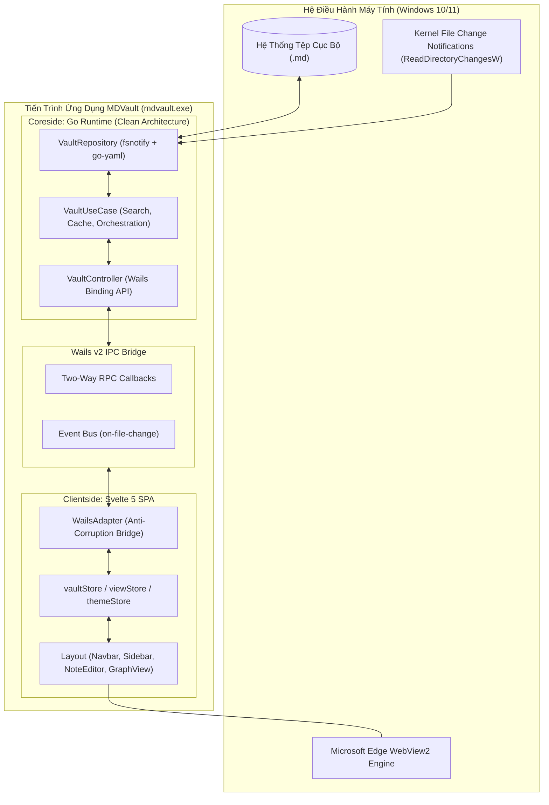
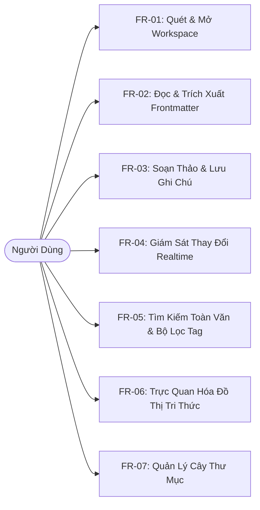

# MDVault - Software Requirements Specification (SRS)

> **Mã tài liệu:** SRS-MDVAULT-IEEE830-2026  
> **Tiêu chuẩn tuân thủ:** IEEE Std 830-1998 Recommended Practice for SRS  
> **Dự án:** MDVault Desktop Application  
> **Phiên bản:** 1.0.0-PRO  
> **Trạng thái:** Approved Baseline  

---

## 1. Giới Thiệu (Introduction)

### 1.1. Mục đích tài liệu (Purpose)
Tài liệu Đặc Tả Yêu Cầu Phần Mềm (SRS) này xác định chi tiết và toàn diện các yêu cầu chức năng (Functional Requirements - FR) và phi chức năng (Non-Functional Requirements - NFR) của ứng dụng **MDVault**. Tài liệu đóng vai trò là cơ sở hợp đồng kỹ thuật cho các kỹ sư phát triển phần mềm (Software Engineers), kỹ sư kiểm thử (QA/QC Engineers), và kiến trúc sư hệ thống (System Architects) trong suốt vòng đời phát triển và bảo trì sản phẩm.

### 1.2. Phạm vi sản phẩm (Scope)
**MDVault** là ứng dụng máy tính cá nhân (Desktop Client Application) phục vụ nhu cầu lưu trữ, phân loại, tìm kiếm, soạn thảo và trực quan hóa ghi chú định dạng Markdown (`.md`) trên hệ thống tệp cục bộ. Ứng dụng hoạt động dựa trên sự phối hợp giữa nhân backend viết bằng ngôn ngữ **Go 1.22+** và giao diện người dùng viết bằng **Svelte 5 + Vite**, kết nối thông qua cơ chế Inter-Process Communication (IPC) của framework **Wails v2**.

### 1.3. Định nghĩa & Từ viết tắt (Definitions & Acronyms)
- **PKM (Personal Knowledge Management):** Hệ thống quản lý tri thức cá nhân.
- **IPC (Inter-Process Communication):** Cơ chế giao tiếp tiến trình giữa backend Go và WebView frontend.
- **YAML Frontmatter:** Siêu dữ liệu đặt tại đỉnh file Markdown, ngăn cách bởi hai hàng ba dấu gạch ngang (`---`).
- **Wiki-link:** Cú pháp tham chiếu chéo giữa các ghi chú dạng `[[Tên Ghi Chú]]`.
- **Atomic Write:** Kỹ thuật ghi tệp nguyên tử bằng cách ghi vào tệp tạm trước khi đổi tên, đảm bảo chống mất mát dữ liệu khi gặp sự cố ngắt nguồn.
- **FDD (Feature-Driven Design):** Mô hình thiết kế phần mềm hướng theo từng tính năng độc lập.

---

## 2. Mô Tả Tổng Quan Hệ Thống (Overall Description)

### 2.1. Phối cảnh sản phẩm (Product Perspective)
MDVault là một hệ thống độc lập hoàn toàn (Self-contained Desktop Application), không phụ thuộc vào bất kỳ máy chủ từ xa hay dịch vụ đám mây nào.

### 2.2. Môi trường vận hành (Operating Environment)
- **Hệ điều hành:** Microsoft Windows 10 (Build 1809 trở lên) hoặc Windows 11 (64-bit Architecture). Sẵn sàng mở rộng sang macOS (12+) và Linux (Ubuntu 22.04+).
- **Runtime phụ thuộc:** Microsoft Edge WebView2 Runtime (đã tích hợp sẵn trên Windows 10/11).
- **Yêu cầu phần cứng tối thiểu:**
  - CPU: 1.0 GHz x64 Processor.
  - RAM: Tối thiểu 512MB RAM khả dụng.
  - Ổ cứng: Tối thiểu 50MB dung lượng trống để cài đặt và vận hành.

### 2.3. Ràng buộc thiết kế và triển khai (Design Constraints)
- **Ngôn ngữ Backend:** Go 1.22+ sử dụng thư viện chuẩn `os`, `path/filepath`, `sync`, kết hợp với `github.com/wailsapp/wails/v2`, `github.com/fsnotify/fsnotify`, `github.com/goccy/go-yaml`.
- **Ngôn ngữ Frontend:** Svelte 5, TypeScript 5.x, Vite 5.x, Tailwind CSS v4, `markdown-it`, `@xyflow/svelte`.
- **Bảo mật:** Không mở bất kỳ cổng mạng (TCP/UDP port) lắng nghe ngoại vi nào; không thực hiện cuộc gọi HTTP/HTTPS ra ngoài Internet.

---

## 3. Yêu Cầu Chức Năng Chi Tiết (Functional Requirements)

### FR-01: Quét & Mở Thư Mục Workspace (Recursive Workspace Scan)
- **Mã yêu cầu:** `REQ-FUNC-01`
- **Mô tả:** Hệ thống cho phép người dùng kích hoạt hộp thoại chọn thư mục gốc của hệ điều hành, sau đó duyệt đệ quy (recursive traversal) để trích xuất toàn bộ cây thư mục và tất cả các file có phần mở rộng `.md` hoặc `.markdown`.
- **Đầu vào (Input):** Tín hiệu kích hoạt từ UI hoặc đường dẫn thư mục `dirPath: string`.
- **Quy trình xử lý (Processing):**
  1. Kiểm tra tính hợp lệ và quyền đọc của thư mục `dirPath`.
  2. Khởi tạo đối tượng `model.WorkspaceData`.
  3. Thực hiện thuật toán duyệt cây thư mục `filepath.WalkDir`.
  4. Bỏ qua các thư mục ẩn hoặc thư mục hệ thống (ví dụ: `.git`, `node_modules`).
  5. Đăng ký đường dẫn thư mục với module giám sát thời gian thực `fsnotify.Watcher`.
- **Đầu ra (Output):** Cấu trúc dữ liệu JSON biểu diễn cây thư mục (`Folders`), danh sách các ghi chú (`Notes`), và danh sách tổng hợp tất cả các tag phát hiện được (`AllTags`).
- **Xử lý ngoại lệ:** Nếu đường dẫn không tồn tại hoặc không có quyền truy cập, trả về mã lỗi `ERR_WORKSPACE_INVALID`.

### FR-02: Phân Tích & Quản Trị YAML Frontmatter (Frontmatter Parsing)
- **Mã yêu cầu:** `REQ-FUNC-02`
- **Mô tả:** Với mỗi file markdown được quét, hệ thống tách riêng phần siêu dữ liệu (Frontmatter) nằm giữa hai cặp dấu ba gạch ngang (`---`) tại đỉnh file.
- **Quy tắc giải mã:**
  1. Sử dụng parser `go-yaml` để giải mã các trường `title: string`, `tags: []string`, `icon: string`.
  2. Nếu không tìm thấy trường `title` trong Frontmatter, hệ thống tự động tìm dòng tiêu đề Heading 1 đầu tiên (`# Tiêu đề`).
  3. Nếu không có Heading 1, hệ thống lấy tên file (loại bỏ đuôi `.md`) làm tiêu đề hiển thị.
  4. Phần văn bản còn lại sau khối Frontmatter được lưu trữ vào trường `Content`.
  5. Tạo chuỗi tóm tắt `Excerpt` (tối đa 150 ký tự đầu tiên loại bỏ cú pháp markdown) để hiển thị trên danh sách xem nhanh.

### FR-03: Soạn Thảo & Lưu Trữ Tệp Nguyên Tử (Atomic Note Persistence)
- **Mã yêu cầu:** `REQ-FUNC-03`
- **Mô tả:** Hệ thống hỗ trợ người dùng cập nhật nội dung văn bản, tiêu đề và danh sách nhãn (tags) của ghi chú hiện tại và lưu trực tiếp xuống ổ cứng.
- **Quy trình xử lý:**
  1. Frontend gọi hàm IPC `SaveNoteContent(filePath, content, title, tags)`.
  2. Backend Go tái cấu trúc lại khối YAML Frontmatter chuẩn xác.
  3. Sử dụng kỹ thuật Atomic Write: Ghi nội dung mới vào một tệp tạm cùng thư mục (`filePath + ".tmp"`).
  4. Sau khi ghi thành công và gọi lệnh `file.Sync()`, thực hiện lệnh `os.Rename` thay thế tệp đích.
  5. Giải phóng khóa luồng và phát tín hiệu hoàn tất.
- **Đầu ra:** Trả về `nil` khi lưu thành công, hoặc `error` nếu không có quyền ghi.

### FR-04: Giám Sát Thay Đổi Hệ Thống Tệp Realtime (File System Watcher)
- **Mã yêu cầu:** `REQ-FUNC-04`
- **Mô tả:** Ứng dụng tự động phát hiện mọi thao tác thêm, xóa, sửa đổi tệp `.md` diễn ra từ các chương trình ngoại vi (VS Code, Notepad, Git checkout, Terminal).
- **Quy trình xử lý:**
  1. Daemon nền của Go chạy vòng lặp bắt sự kiện kênh (Go Channel) từ `fsnotify.Watcher`.
  2. Lọc bỏ các tệp tin tạm hoặc không có đuôi `.md`.
  3. Khống chế xung nhịp (Debounce): Giới hạn tần số phản ứng đối với các sự kiện ghi lặp lại liên tiếp trong khoảng 50ms.
  4. Kích hoạt sự kiện Wails IPC `runtime.EventsEmit(ctx, "on-file-change", filePath)`.
  5. Frontend tiếp nhận sự kiện và tự động làm tươi dữ liệu trong `vaultStore` mà không làm mất vị trí con trỏ của người dùng nếu đang mở file khác.

### FR-05: Tìm Kiếm & Lọc Đa Tiêu Chí (Instant In-Memory Search Engine)
- **Mã yêu cầu:** `REQ-FUNC-05`
- **Mô tả:** Cung cấp chức năng tìm kiếm tức thời với độ trễ dưới 20ms ngay khi người dùng gõ từ khóa.
- **Chức năng:**
  1. Tìm kiếm theo Tag: Nhấp vào Tag trên Sidebar sẽ lọc ngay lập tức các ghi chú có chứa tag đó trong Frontmatter.
  2. Tìm kiếm theo Query: Khớp chuỗi không phân biệt hoa thường (Case-insensitive) trên cả ba trường: `Title`, `Tags`, và toàn văn `Content`.
  3. Hiển thị số lượng kết quả tìm kiếm và làm nổi bật (highlight) từ khóa phù hợp.

### FR-06: Trực Quan Hóa Đồ Thị Mạng Lưới Tri Thức (Knowledge Graph Engine)
- **Mã yêu cầu:** `REQ-FUNC-06`
- **Mô tả:** Phân tích các liên kết chéo hai chiều (Bidirectional Wiki-links) giữa các bài viết và hiển thị dưới dạng đồ thị tương tác.
- **Quy tắc giải mã:**
  1. Sử dụng Regular Expression `/\[\[(.*?)\]\]/g` để quét toàn bộ nội dung của mọi note trong workspace.
  2. Mỗi ghi chú trở thành một Node trong đồ thị với nhãn là Tiêu đề của note.
  3. Mỗi liên kết tìm thấy trỏ tới một tiêu đề note khác sẽ sinh ra một Edge nối giữa 2 Node tương ứng.
  4. Render trên canvas đồ thị tương tác sử dụng `@xyflow/svelte`.
  5. Hỗ trợ thao tác Zoom in, Zoom out, Pan, Drag node và nhấp vào node để chuyển sang giao diện đọc/sửa note đó.

### FR-07: Quản Lý Cây Thư Mục & Tạo Mới Tài Liệu
- **Mã yêu cầu:** `REQ-FUNC-07`
- **Mô tả:** Cho phép người dùng tạo nhanh thư mục mới (`CreateFolder`) và tạo mới file markdown (`CreateNote`) với cấu trúc Frontmatter mặc định sẵn có.

---

## 4. Yêu Cầu Phi Chức Năng (Non-Functional Requirements - NFR)

### 4.1. Hiệu năng (Performance - NFR-01)
- **Thời gian khởi động (Cold Start):** Thời gian từ khi kích hoạt tiến trình `mdvault.exe` đến khi khung giao diện đầu tiên hiển thị sẵn sàng nhận tương tác không vượt quá **300 mili-giây** trên cấu hình máy tiêu chuẩn.
- **Tiêu thụ bộ nhớ tĩnh (RAM Idle):** Ứng dụng ở trạng thái chờ không tiêu tốn quá **50 MB RAM**.
- **Tốc độ tìm kiếm (Search Throughput):** Thời gian thực thi tìm kiếm trên kho 5.000 tệp ghi chú không vượt quá **20 mili-giây**.
- **Độ trễ phản ứng file ngoại vi:** Sự kiện `on-file-change` được truyền tải lên UI trong vòng dưới **15 mili-giây** kể từ khi OS Kernel ghi nhận.

### 4.2. Bảo mật & Riêng tư (Security & Privacy - NFR-02)
- **Chính sách Zero Telemetry:** Không tích hợp bất kỳ công cụ theo dõi hành vi người dùng (như Google Analytics, Sentry cloud) hoặc gửi gói tin ra mạng ngoài.
- **Sandbox nội dung WebView:** Vô hiệu hóa tính năng điều hướng URL ngoại vi trong WebView để ngăn chặn rủi ro Cross-Site Scripting (XSS) khi render các file markdown chứa mã HTML độc hại.
- **Toàn vẹn tệp (Data Integrity):** Kỹ thuật ghi tệp nguyên tử (Atomic Write) triệt tiêu hoàn toàn rủi ro file bị rỗng (0 KB corruption) khi ứng dụng bị tắt đột ngột hoặc mất nguồn điện.

### 4.3. Độ tin cậy & An toàn đồng thời (Reliability & Concurrency - NFR-03)
- **Mutex Thread Safety:** Mọi thao tác truy cập bộ nhớ đệm danh sách tệp, xử lý sự kiện file watcher và ghi đĩa tại tầng Repository Backend phải được bảo vệ bởi khóa độc quyền `sync.Mutex`, đảm bảo không xảy ra hiện tượng Data Race khi kiểm tra bằng cờ `-race` của Go.
- **Tự động phục hồi:** Nếu file watcher gặp lỗi tạm thời (ví dụ: thư mục bị khóa bởi tiến trình sao lưu), hệ thống tự thử lại (retry) mà không gây sập (panic) ứng dụng.

### 4.4. Tính khả chuyển & Đóng gói (Portability - NFR-04)
- **Tệp nhị phân đơn nhất:** Ứng dụng được biên dịch thành một file thực thi độc lập (Single Portable Binary), không yêu cầu người dùng phải cài đặt thêm Go, Node.js hay môi trường phụ trợ.
- **Kích thước gói:** Dung lượng file nhị phân sau khi strip debug symbol không vượt quá **25 MB**.

---

## 5. Ma Trận Truy Vết Yêu Cầu (Traceability Matrix)

| Mã Yêu Cầu SRS | Mô Tả | Mã Epic PRB | Thành Phần Kiến Trúc HLD | Module Triển Khai LLD |
| :---: | :--- | :---: | :--- | :--- |
| **FR-01** | Quét & Mở Workspace | EPC-01 | VaultUseCase / Repository | `vault_repository_impl.go`, `wailsAdapter.ts` |
| **FR-02** | Xử lý Frontmatter | EPC-02 | Infrastructure FileSystem | `go-yaml` Parser, `models.go` |
| **FR-03** | Lưu Ghi Chú Nguyên Tử | EPC-04 | Infrastructure / Controller | `SaveNoteContent()`, `NoteEditor.svelte` |
| **FR-04** | Watcher Thời Gian Thực | EPC-03 | fsnotify Engine / Wails IPC | `fsnotify.Watcher`, `runtime.EventsEmit` |
| **FR-05** | Tìm Kiếm & Lọc Tag | EPC-05 | VaultUseCase / Svelte Store | `SearchNotes()`, `vaultStore.ts` |
| **FR-06** | Đồ Thị Tri Thức | EPC-06 | Frontend Feature Module | `graphBuilder.ts`, `GraphView.svelte` |
| **FR-07** | Quản Trị Cây Thư Mục | EPC-08 | Controller & UseCase | `CreateFolder()`, `FolderTreeItem.svelte` |
