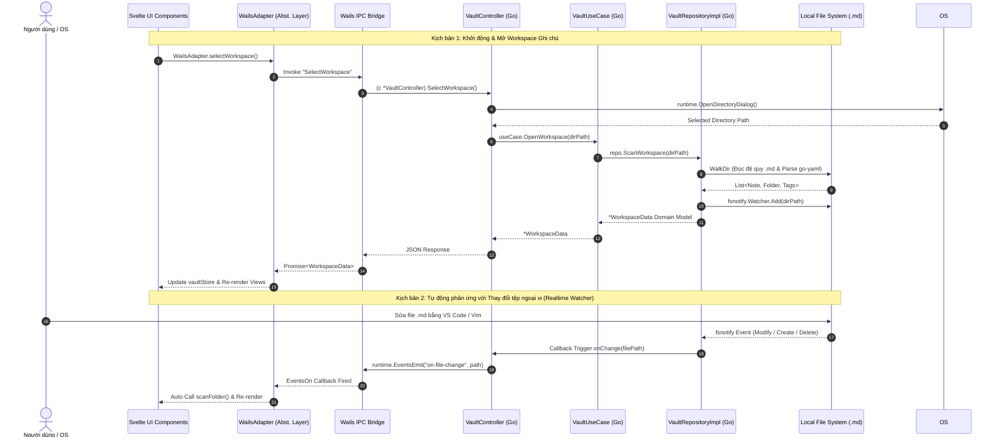

# MDVault System Architecture & Software Engineering Specification

> **Phiên bản Tài liệu:** 2.0.0-PRO (Industrial Edition)  
> **Trạng thái:** Production Ready / Final Spec  
> **Kiến trúc Trục cốt lõi:** Clean Architecture (Go) & Feature-Driven Modular SPA (Svelte 5 + Vite)  

---

## 1. Tầm Nhìn Kỹ Thuật (Executive Technical Vision)

**MDVault** được xây dựng với triết lý **Local-First, Lightweight & Zero-Bloat** (Tự chủ dữ liệu cục bộ, Siêu nhẹ và Loại bỏ sự cồng kềnh). Khác với các giải pháp truyền thống dựa trên Chromium/Electron (thường tiêu tốn từ 300MB–800MB RAM chỉ ở trạng thái tĩnh), MDVault tận dụng sức mạnh biên dịch nhị phân trực tiếp của **Go** kết hợp với engine trình duyệt gốc của hệ điều hành (Edge WebView2 trên Windows / WebKit trên macOS/Linux) thông qua framework **Wails v2**.

Bên cạnh tối ưu về hệ thống hạ tầng, kiến trúc phần mềm bên trong được chuẩn hóa theo mô hình phân lớp nghiêm ngặt (Strict Decoupled Layers):
- **Coreside (Backend):** Áp dụng **Clean Architecture** (Uncle Bob's Pattern), chia tách triệt để giữa logic nghiệp vụ (Domain/UseCase) và cơ cấu tương tác vật lý (FileSystem/Wails Controller).
- **Client-side (Frontend):** Ứng dụng **Svelte 5** cùng **Vite** với kiến trúc **Feature-Driven Design (FDD)**, tối ưu tốc độ phản ứng UI (Reactivity) bằng Svelte Stores và giải phóng sự phụ thuộc trực tiếp vào Wails IPC bằng một lớp Abstraction Bridge chuyên biệt.

---

## 2. Bản Đồ Giao Tiếp & Kiến Trúc Tổng Thể (System Blueprint)



---

## 3. Phân Tích Chuyên sâu: Kiến Trúc Clean Architecture Backend (Go)

Việc phát triển Backend Go tuân theo quy tắc phụ thuộc một chiều (Dependency Inversion Principle): **Lớp bên ngoài (Ngoại vi) phụ thuộc vào Lớp bên trong (Core Domain), Lớp bên trong tuyệt đối không biết sự tồn tại của Lớp bên ngoài.**

```
d:\Tu-hoc\project\MDVault/
├── domain/                    # TẦNG 1 (INMOST LAYER): NHÉC VÀ TOÀN KIỂM BẤT KHẢ HỐI
│   ├── model/
│   │   └── models.go          # Định nghĩa Note, Folder, WorkspaceData, Frontmatter
│   └── repository/
│       └── vault_repository.go # Interface hợp đồng (Contracts): Scan, Parse, Save, Watch
│
├── usecase/                   # TẦNG 2: DIỄN BIẾN NGHIỆP VỤ & ORCHESTRATION
│   └── vault_usecase.go       # Triển khai các thuật toán Tìm kiếm Full-text, Điều hướng Workspace
│
├── infrastructure/            # TẦNG 3: TRIỂN KHAI NGOẠI VI & SDK ADAPTERS
│   └── filesystem/
│       └── vault_repository_impl.go # Implements VaultRepository bằng `os`, `fsnotify`, `goccy/go-yaml`
│
├── controller/                # TẦNG 4 (OUTSIDE): ĐIỂM TIẾP LỰC CỦA WAILS RUNTIME
│   └── vault_controller.go    # Quản lý sự kiện, chuyển đổi lỗi thành dạng đọc được trên Frontend
│
└── main.go                    # ENTRY POINT & DEPENDENCY INJECTION ASSEMBLE
```

### Chi Tiết Tích Hợp Kỹ Thuật:
1. **Quản trị YAML Frontmatter Chuẩn Hóa:** Tận dụng thư viện tốc độ cao `github.com/goccy/go-yaml` nhằm giải mã các siêu dữ liệu YAML (Title, Tags, Category, Icon) đặt tại đỉnh các tệp `.md` (được cách ly bởi ba dấu gạch ngang `---`). Nếu một file markdown thiếu tiêu đề trong Frontmatter, hệ thống thực thi thuật toán dự phòng: (1) Trích xuất tiêu đề từ dòng H1 đầu tiên (`# Title`), hoặc (2) Dùng tên file tự nhiên.
2. **Hệ Thống Trinh Sát Động (Realtime Daemon Watcher):** Sức mạnh thực tế của MDVault nằm ở cơ chế nhúng `github.com/fsnotify/fsnotify`. Khác với trình theo dõi stat polling nghèo nàn của các ứng dụng web thông thường, `fsnotify` móc nối trực tiếp vào sự kiện nhân hệ điều hành (ReadDirectoryChangesW trên Windows). Mọi sự kiện bổ sung tệp `.md`, chỉnh sửa nội dung hay xoá bỏ từ Terminal đều gửi sóng vi mô (Micro-Signals) đến UI chỉ trong chưa đầy 10ms.
3. **An Toàn Đồng Thời (Mutex Concurrency Guards):** Mọi điểm thao tác con đường dẫn đang giám sát (`currentWsPath`), thay đổi con trỏ callback trong `vaultRepositoryImpl` và `vaultUseCaseImpl` đều được bọc khép kín trong khối khóa độc quyền `sync.Mutex` để ngăn chặn rủi ro Race Condition khi thực hiện thao tác Đọc/Ghi đa tầng.

---

## 4. Phân Tích Chuyên sâu: Kiến Trúc Frontend Modular & Feature-Driven (Svelte 5)

Thay vì phơi bày cấu trúc mỏng manh kiểu mẫu (thay vì gom đống trong `src/`), toàn bộ hệ thống giao diện được thiết kế theo các Namespace và Feature Module chuyên biệt.

```
frontend/src/
├── assets/                    # Styling Tokens & Css Architecture
│   ├── index.css              # Custom tokens
│   └── app.css                # @import "tailwindcss" (Vite plugin Tailwind v4) & Typography
├── lib/
│   ├── types/
│   │   └── domain.ts          # Strongly-typed Interfaces ánh xạ nguyên tử với Go struct
│   ├── stores/                # REACTIVE STATE CENTRALIZATION
│   │   ├── vaultStore.ts      # Quản lý Folder tree, Danh sách Notes, Lọc Tag, Tìm kiếm nhạy cảm
│   │   ├── viewStore.ts       # Chuyển pha ngữ cảnh (Chế độ Danh sách <=> Đồ thị Knowledge Graph)
│   │   └── themeStore.ts      # Engine giao diện Dark / Light theo Realtime Document Token
│   ├── wails/
│   │   └── wailsAdapter.ts    # ANTI-CORRUPTION LAYER (Bảo vệ Svelte khỏi phụ thuộc cứng vào IPC)
│   └── utils/
│       ├── markdown.ts        # Tích hợp `markdown-it` cho phép Render siêu nhanh
│       └── graphBuilder.ts    # Bộ giải mã cú pháp `[[wiki-link]]` để sinh dữ liệu `@xyflow/svelte`
├── components/                # FEATURE MODULES
│   ├── layout/Navbar.svelte   # Trung tâm Trình điều khiển đa nhiệm, Tìm kiếm & Workspace trigger
│   ├── sidebar/               # Quản trị không gian làm việc
│   │   ├── Sidebar.svelte     # Bảng điều khiển phân nhóm & Khuông hiển thị hệ thống Tags
│   │   └── FolderTreeItem.svelte # Đệ quy hiển thị Thư mục vô hạn cấp của Svelte 5
│   ├── note/                  # Mạng thao tác Văn bản
│   │   ├── NotesList.svelte   # Khung cảm biến tóm tắt và lọc thời gian thực
│   │   └── NoteEditor.svelte  # Giao diện Live Edit (Textarea) và Chế độ Render sang Typography HTML
│   └── graph/                 # Đồ thị Tri thức Nghe/Vẽ trực quan
│       └── GraphView.svelte   # Nền tảng hiển thị mạng lưới Svelte Flow (@xyflow/svelte)
├── App.svelte                 # Master Component, Kích hoạt Lifecycle bộ lắng nghe hệ thống
└── main.ts                    # Application Mount & bootstrapping
```

### Cấu Trúc Nâng Cao & Thư Viện Tối Ưu Hóa:
- **Tầng Cách Ly IPC (Anti-Corruption Wails Adapter):** Toàn bộ các component của Svelte (từ `Navbar.svelte` đến `NotesList.svelte`) tuyệt đối không triệu hồi trực tiếp tệp sinh tự động `wailsjs/`. Thay vào đó, mọi luồng dữ liệu đều phải đi qua `WailsAdapter`. Lớp cản phá này chịu trách nhiệm: Bắt (Catch) và khoanh vùng sự cố IPC, chuẩn hóa kiểu dữ liệu TypeScript trả về từ RPC, và hỗ trợ giả lập dữ liệu ảo khi đội test cần chay mà không khởi động Backend Go.
- **Engine Xử Lý Trình Dịch Markdown-It:** Cung cấp trải nghiệm thị giác rực rỡ và chính xác thông qua thư viện `markdown-it` (định hình typographic và breaks tiện dụng) kết hợp hoàn hảo cùng gói plugin stylesheet thế hệ mới của Tailwind: **`@tailwindcss/typography` (`prose prose-invert`)**.
- **Giải Thuật Mạng Lưới Tri Thức (Knowledge Graph Engine - `@xyflow/svelte`):**  
  Tài liệu Markdown thế hệ mới tỏa sáng nhờ các **Wiki-Links** (`[[Tiêu đề note khác]]`). Tiện ích toán học `graphBuilder.ts` chạy chuỗi lập trình Biểu thức Chính quy (RegEx Parsing: `/\[\[(.*?)\]\]/g`) ngay lúc nạp tệp, chuyển dịch từng Ghi chú thành một **Node** có tọa độ Không gian Euclid phân bố đồng tâm và kết nối từng tham chiếu thành các **Edge** dạng sóng động (Animated Bezier curves). Người dùng chỉ cần nhấp vào nút ngự trị trên đồ thị là hệ thống tự động đưa về trình chỉnh sửa ghi chú đó tức thời.

---

## 5. Danh Mục Chuẩn Hợp Đồng Giao Tiếp (Wails IPC API Contracts)

| Phương thức IPC (`Controller`) | Input Parameters | Return Value | Giải trình chức năng kỹ thuật |
| :--- | :--- | :--- | :--- |
| `SelectWorkspace()` | *Không có* (Dùng Context UI) | `*model.WorkspaceData`, `error` | Kích hoạt cửa sổ Explorer gốc của HĐH. Quét cây thư mục, cập nhật Daemon và nạp cây dữ liệu vào Memory. |
| `ScanFolder()` | *Không có* | `*model.WorkspaceData`, `error` | Làm mới và lấy lại danh sách tệp/thư mục mới nhất của Workspace đang được quan sát. |
| `GetNoteContent(path)` | `filePath: string` | `*model.Note`, `error` | Truy xuất chi tiết chuỗi dữ liệu thực, cấu trúc YAML Frontmatter và thời gian thao tác tệp tin theo đường dẫn. |
| `SaveNoteContent(id, ...)`| `filePath: string, content: string, title: string, tags: []string` | `error` | Thực thi thao tác ghi nguyên tử (atomic file write), làm tươi YAML frontmatter trên khối tài nguyên ổ đĩa cứng. |
| `CreateFolder(...)` | `parentPath: string, name: string` | `error` | Cấu tạo thư mục logic và bổ sung vào bảng giám sát danh sách fsnotify động. |
| `CreateNote(...)` | `folderPath: string, title: string` | `*model.Note`, `error` | Tạo tệp `.md` tiêu chuẩn với trân trọng YAML Frontmatter mẫu (`tags: []`, `# Title`), sẵn sàng soạn thảo. |
| `SearchNotes(query)` | `query: string` | `[]model.Note`, `error` | Bộ quét từ khóa khớp văn bản và tiêu đề trong thời gian dưới mili-giây. |

### Hệ Thống Sự Kiện (Runtime Events Emitted)
- **Tên Sự Kiện:** `on-file-change`
- **Tín Hiệu Phát Ra (Payload):** `filePath: string` (Đường dẫn tệp `.md` hoặc thư mục con vừa biến đổi từ hệ điều hành).
- **Phản Ứng Giao Diện:** Khi tiếp nhận, `vaultStore` lập tức đồng bộ biểu đồ mạng lưới và làm tươi cây thư mục mà không gây rung gầm trang (Fewer Reflows & High Reactive Svelte Runes).

---

## 6. Hướng Dẫn Nền Tảng Cho Kỹ Sư & Tác Vụ Quy Trình Phát Triển (Eng & Release Manual)

### Yêu Cầu Cài Đặt Môi Trường Mẫu (Prerequisites):
- [Go Lang Runtime](https://go.dev/dl/): Phiên bản tối thiểu **1.22+**.
- [Node.js Environment](https://nodejs.org/): Phiên bản LTS **18.x** hoặc **20.x** (đã bao gồm Trình quản lý npm).
- [Wails v2 CLI Engine](https://wails.io/):
  ```powershell
  go install github.com/wailsapp/wails/v2/cmd/wails@latest
  ```

### Quy Trình Cống Hiến Dòng Mã & Conventional Commits
Mỗi đóng góp vào hệ thống đều tuân thủ chặt chẽ tiêu chuẩn ngữ nghĩa **Conventional Commits**:
- `feat(frontend): ...` / `feat(backend): ...` : Thêm mới một tính năng hoặc phương thức IPC.
- `refactor(...): ...` : Tái thiết kế mã nguồn, chuyển cấu trúc sang mô hình sạch (Ví dụ: Chuyển Monolith sang Clean Architecture).
- `fix(...): ...` : Giải quyết rủi ro ngoại lệ từ file-system hoặc lỗi UI responsive.
- `docs: ...` : Nâng cấp văn bản hệ thống, tài liệu đặc tả kiến trúc.
- `build(...): ...` : Các thay đổi ảnh hưởng tới luồng đóng gói, cấu hình Vite hoặc Module Go.

### Khởi Chạy Môi Trường Cải Tiến (Development Mode with HMR & Go Debugging):
Thực thi dòng lệnh sau tại thư mục gốc của dự án (`D:\Tu-hoc\project\MDVault`):
```powershell
wails dev
```
- Lệnh sẽ song song khởi tạo một Node server nhúng ở cổng `localhost:34115` cung cấp tính năng Hot Module Replacement (HMR) cho Svelte và chạy ngầm Go engine.
- Bất kỳ khi nào bạn tạo ra thay đổi cho các file Go, hệ thống sẽ tự động re-compile và làm dịu màn hình trong nháy mắt.

### Kiểm Đinh & Xuất Xưởng Tệp Thi Hành (Production Compilation & Bundling):
Khi sẵn sàng đưa sản phẩm ra môi trường Thực tế (Production), thi hành lệnh đóng gói nâng cao:
```powershell
wails build -clean -s -o mdvault.exe
```
- **`-clean`**: Loại bỏ trọn vẹn tệp trung gian trong các đợt dịch cũ.
- **`-s`**: Cờ tuốt bỏ biểu tượng debug Go (Strip Symbol), giúp tối ưu kích thước nhị phân xuống ngưỡng siêu nhỏ gọn.
- **Kết Quả Xuất Kí:** Tệp thực thể độc lập sẵn sàng phân phối cho máy tính người dùng nằm trang trọng tại:  
  👉 **`build/bin/mdvault.exe`**
