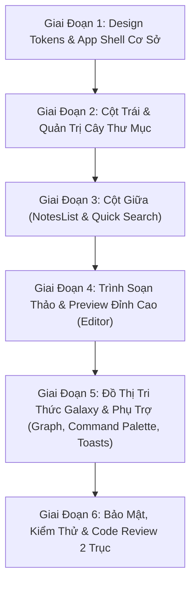

# Kế Hoạch Cải Tạo Toàn Diện Giao Diện MDVault (UI/UX Redesign Master Plan)

> **Điều phối bởi:** `mdvault-orchestrator` (Skill Mẹ)  
> **Các kỹ năng chuyên môn tham gia:**  
> - `planning-and-task-breakdown` (Lập lộ trình & phân rã lát cắt)  
> - `impeccable` (Tiêu chuẩn thẩm mỹ, Design System, Craft Floor, Anti-Slop)  
> - `apple-design` (Vật liệu kính mờ, độ sâu tầng thứ, phản hồi đàn hồi spring physics)  
> - `emil-design-eng` (Kỹ thuật vi tương tác, Sonner toast, chuyển động có chủ đích, custom curves)  
> - `frontend-design` & `design-taste-frontend` (Typography Geist, bố cục tỉ lệ vàng, phối màu không gian tối tân)  
> - `security-and-hardening` (XSS Sanitizer cho WebView2 Markdown, Sandbox Isolation)  
> - `incremental-implementation` & `code-review` (Triển khai lát cắt mỏng & rà soát nghiệm thu 2 trục)  
>  
> **Phiên bản:** 2.0.0-PRO Revamp  
> **Mục tiêu:** Nâng tầm MDVault từ một ứng dụng MVP giao diện phẳng đơn điệu thành một Desktop PKM Client đẳng cấp Apple macOS / Craft / Obsidian tiêu chuẩn quốc tế.

---

## 1. Báo Cáo Thẩm Mỹ & Đánh Giá Hiện Trạng (UI/UX Audit & Critique)

Theo chỉ dẫn của `impeccable` và `emil-design-eng`, hệ thống phân tích các điểm nghẽn thị giác và tương tác hiện tại:

| Thành phần | Hiện trạng (AI-Slop / MVP) | Vấn đề cốt lõi | Giải pháp Tinh hoa (Apple & Emil Standard) |
| :--- | :--- | :--- | :--- |
| **Bảng màu & Nền** | Nền đen đặc (`bg-black`), tương phản gắt (`text-zinc-200`) | Gây mỏi mắt, thiếu chiều sâu (flat), không có cảm giác vật liệu | Phối màu đa tầng: Kính mờ `backdrop-blur-xl`, nền obsidian sâu `bg-zinc-950/80`, viền vi tế `border-white/[0.08]`, ánh sáng viền bề mặt (top-edge highlight) |
| **App Shell & Bố cục** | Chiều rộng cứng nhắc (`w-64`, `w-80`), cố định chiều cao | Không co giãn được khi làm việc với tài liệu dài; không gian chật chội | Thiết kế 3 cột linh hoạt với khả năng thu/phóng Sidebar mượt mà; hỗ trợ Focus Mode (ẩn thanh công cụ và danh sách ghi chú khi viết) |
| **Thanh Tiêu Đề (Navbar)** | Giao diện thanh web bình thường, nút bấm rời rạc | Không mang phong thái Desktop Client; thiếu Command Palette | Chuyển thành Desktop Chrome tích hợp: Tích hợp Command Palette `Ctrl+K` trigger, Theme switch toggle, Quick Action Pills, Sync status pill |
| **Cây Thư Mục (Sidebar)** | Hộp nhập tạo thư mục/note chèn thô trong danh mục; cây phẳng | Rối mắt khi tạo note mới; icon thiếu sinh động | Dialog/Pop-up thông minh origin-aware; Cây thư mục lồng nhau hỗ trợ xoay mũi tên chevron đàn hồi, đếm số note trực tiếp |
| **Danh Sách Ghi Chú (NotesList)** | Card chữ nhật đơn giản, line active là dải trắng thô | Thiếu phân cấp thông tin; ranh giới cứng nhắc | Note Card cao cấp: Badge tag sắc nét, hiển thị thời gian tương đối (`relative-time`), dải active phát quang mềm (soft neon glow `0 0 12px rgba(...)`) |
| **Trình Soạn Thảo (Editor)** | Chuyển đổi Edit/Preview bằng nút rời rạc; Textarea thô sơ | Trải nghiệm đứt gãy, không có format thanh công cụ, thiếu split-view | Thêm chế độ Split View (vừa gõ vừa xem song song) hoặc Live Preview; Toolbar định dạng nhanh (B, I, H1, Link, Code); Interactive tag chips |
| **Đồ Thị Tri Thức (GraphView)** | Node vuông cơ bản từ thư viện XYFlow; bố trí tròn đơn điệu | Nhìn như sơ đồ kỹ thuật, không có tính thẩm mỹ "Galaxy PKM" | Custom Node đồ họa phong cách Thiên hà (Obsidian Galaxy Style): Node phát sáng theo mật độ liên kết, màu sắc theo Tag, Controls kính mờ cao cấp |
| **Micro-Interactions** | Hiệu ứng giật cục hoặc thiếu transition | Thiếu xúc giác (tactile feedback) khi nhấp chuột | Quy chuẩn `:active scale(0.97)`, custom curve `cubic-bezier(0.23, 1, 0.32, 1)`, Sonner Toast thông báo trang nhã |
| **Bảo mật WebView2** | `markdown-it` cấu hình `html: true` không có sanitize | Nguy cơ XSS trong WebView2 khi file markdown chứa thẻ `<script>` độc hại | Tích hợp lớp khử khuẩn XSS (DOMPurify sanitizer) đảm bảo chuẩn `security-and-hardening` |

---

## 2. Hệ Thống Thiết Kế & Token Thẩm Mỹ (Design System Tokens)

Theo hướng dẫn `frontend-design` và `apple-design`, ta thiết lập hệ quy chuẩn thị giác:

### 2.1. Bảng Màu & Vật Liệu (Palette & Glass Materials)
- **Deep Slate / Obsidian Backgrounds:**
  - Base: `#09090b` (Zinc-950)
  - Surface Elevated: `rgba(24, 24, 27, 0.75)` với `backdrop-blur-xl`
  - Floating Panels: `rgba(39, 39, 42, 0.65)`
  - Active Surface: `rgba(255, 255, 255, 0.08)`
- **Accents & Glowing Highlights:**
  - Electric Indigo: `#6366f1` (Active indicators, primary actions)
  - Emerald Green: `#10b981` (Saved state, sync success)
  - Amber Gold: `#f59e0b` (Tags, warnings, pins)
  - Border Sheen: `border-white/[0.08]` kết hợp top highlight `border-t-white/[0.15]`

### 2.2. Kiểu Chữ (Typography & Optical Sizing)
- **Font Gia Đình:** Geist Sans (Giao diện) + Geist Mono (Mã nguồn, thẻ tag, metadata).
- **Quy tắc Optical Sizing:**
  - Heading Display: `letter-spacing: -0.03em`, `font-weight: 700`, `line-height: 1.1`
  - Body Text: `letter-spacing: -0.01em`, `font-weight: 400`, `line-height: 1.6`
  - Code / Mono: `letter-spacing: -0.02em`, `font-size: 13px`

### 2.3. Quy Chuẩn Động Học (Motion Physics)
- **Springs cho Modal/Panels:** Apple Damping `1.0`, Response `0.35s` (Critically damped - Không rung lắc lố lăng).
- **Micro-interact Nút bấm:** `:active { transform: scale(0.97); }` (Thời gian phản hồi 120ms).
- **Custom Easing Curve:** `--ease-apple: cubic-bezier(0.23, 1, 0.32, 1)`.

---

## 3. Phân Rã Lộ Trình Triển Khai (Phased Vertical Slices)

Kế hoạch được chia thành 5 giai đoạn rõ ràng, tuân thủ `incremental-implementation`:

### Giai Đoạn 1: Tái Thiết Lập Nền Móng & App Shell (Foundation & Tokens)
- Chuẩn hóa CSS Variables trong `app.css` (Glassmorphism, Layered Shadows, Custom Curves).
- Thiết kế thanh điều khiển Desktop Header chuẩn macOS/Windows với Nút Toggle Sidebar, Breadcrumb thông minh, Quick Switcher trigger.
- Bổ sung Theme Toggle hoàn chỉnh (Dark Mode sang chảnh & Light Mode giấy ngà mịn màng).

### Giai Đoạn 2: Trải Nghiệm Cây Thư Mục Đẳng Cấp (Sidebar & Tree Navigation)
- Cải tạo `Sidebar.svelte` và `FolderTreeItem.svelte`: Icon động (animated folder icons), Chevron xoay mượt mà, Active pill nền mờ.
- Tạo Modal/Popover nhỏ gọn xuất hiện từ vị trí trigger (Origin-aware) khi bấm New Folder / New Note thay vì ép form thô bạo vào giữa thanh sidebar.
- Phần Tags biến thành tag pill mây (interactive cloud tags) với số lượng và màu phân biệt.

### Giai Đoạn 3: Danh Sách Ghi Chú & Thẻ Bài Sang Trọng (Notes List & Filtering)
- Tái thiết kế `NotesList.svelte`: Note Card đa tầng với hiệu ứng hover nâng card nhẹ (`translate-y-[-1px]`, viền sáng).
- Dải Active Glow tinh tế với hiệu ứng chuyển tiếp mượt mà.
- Thanh công cụ danh sách: Bộ lọc sắp xếp (Mới nhất, Cũ nhất, Tên A-Z), Đếm số lượng động, Trạng thái rỗng (Empty State) minh họa đồ họa cao cấp.

### Giai Đoạn 4: Trình Soạn Thảo Siêu Cấp & An Toàn Tuyệt Đối (Editor, Split View & Security)
- Nâng cấp `NoteEditor.svelte`: Hỗ trợ 3 chế độ (Editor Only, Preview Only, Split View song song).
- Chế độ nhập Tag dạng Interactive Tag Input: Gõ Enter tự biến thành Chip badge có nút xóa x, ngăn ngừa lỗi định dạng.
- Thanh công cụ định dạng Markdown nhanh (Format Bar): Bold, Italic, Code, Heading, Bullet List, Task List, Link.
- Tích hợp lớp khử khuẩn XSS vào `markdown.ts` loại bỏ nguy cơ script độc hại khi render HTML trong WebView2.
- Làm đẹp Typography của khối Preview: Code highlight box với nút "Copy", Callout blocks (Note, Tip, Warning), Checkbox tương tác.

### Giai Đoạn 5: Đồ Thị Tri Thức Galaxy & Tương Tác Bàn Phím (Galaxy Graph & Polish)
- Biến `GraphView.svelte` thành "Galaxy Knowledge Map": Node tùy biến phát sáng hạt nhân (Glow Node), đường nối mềm mại có hiệu ứng gradient.
- Bổ sung hệ thống **Sonner Toast**: Thông báo mini sang chảnh xuất hiện góc dưới (Lưu thành công, Mở workspace, Xóa ghi chú).
- Bổ sung **Command Palette (`Ctrl+K`)**: Tìm kiếm mọi note, folder, đổi chế độ hiển thị chỉ bằng bàn phím trong tích tắc.

### Giai Đoạn 6: Rà Soát Chất Lượng, Kiểm Thử & Nghiệm Thu (Quality & Code Review)
- Kiểm tra tính tương thích và build thử nghiệm với Vite & Svelte Check.
- Rà soát Code Review theo 2 trục của `mdvault-orchestrator`:
  - **Trục Standards:** Clean Architecture, quy chuẩn TypeScript Svelte 5 runes, không có inline smell.
  - **Trục Spec:** Đáp ứng đầy đủ các yêu cầu trong SRS.md và LLD.md.

---

## 4. Quản Trị Rủi Ro & Giải Pháp Khắc Phục (Risk Management)

| Rủi ro | Mức độ | Biện pháp hạn chế & xử lý |
| :--- | :---: | :--- |
| **Xung đột hiển thị trên WebView2 Windows** | Trung bình | Dùng chuẩn CSS Backdrop-filter có tiền tố dự phòng; kiểm tra độ mờ mượt mà trên Windows GPU rendering. |
| **Suy giảm hiệu năng khi render tài liệu Markdown lớn** | Thấp | Tối ưu hóa bộ nhớ đệm render của `markdown-it`; giới hạn debounce tính toán đồ thị `@xyflow/svelte`. |
| **XSS qua Markdown độc hại** | Cao | Bắt buộc áp dụng bộ lọc HTML sanitize trước khi đưa nội dung vào `{@html ...}` theo chuẩn `security-and-hardening`. |
| **Vỡ giao diện khi người dùng kéo co giãn cửa sổ** | Trung bình | Sử dụng CSS Flexbox/Grid hiện đại, các đơn vị `rem` và `clamp()`, không hardcode kích thước cố định ở các khung chính. |

---

## 5. Tiêu Chuẩn Nghiệm Thu Chung & Quy Trình Thực Thi (Definition of Done & Git Protocol)

### 5.1. Quy Trình Kiểm Thử Bắt Buộc (Testing Protocol)
1. **Type & Compiler Check:** Chạy `npm run check` sau mỗi task để bảo đảm Svelte 5 runes (`$state`, `$derived`, `$effect`) và TypeScript definitions không có lỗi.
2. **Bundle Build Test:** Chạy `npm run build` xác nhận Vite Rollup đóng gói không lỗi cú pháp hoặc hỏng CSS asset.
3. **Security Test:** Với Task 5, kiểm tra bóc tách mã độc XSS payload trước khi hiển thị lên WebView2.
4. **Visual & Interaction Check:** Kiểm tra hiệu ứng kính mờ, phản hồi nút bấm (`:active scale(0.97)`), và tính trơn tru 60fps trên màn hình.

### 5.2. Quy Tắc Cam Kết Git (Git Commit Convention)
Tuân thủ nghiêm ngặt kỹ thuật **Incremental Implementation**:
- **Quy trình:** `Code -> Test/Verify -> Pass Acceptance Criteria -> Git Commit -> Next Task`.
- Mỗi task sở hữu 1 commit độc lập mang thông điệp rõ ràng theo chuẩn Conventional Commits (`feat:`, `style:`, `sec:`, `refactor:`).
- Tuyệt đối không dồn toàn bộ task vào một commit khổng lồ.

### 5.3. Tiêu Chí Nghiệm Thu (Acceptance Criteria)
1. Giao diện loại bỏ 100% cảm giác AI-slop; chuyển động mượt mà ở 60fps.
2. Tất cả các nút bấm và vùng tương tác có hiệu ứng phản hồi xúc giác (`:active scale(0.97)`).
3. Lệnh `npm run build` và `npm run check` trong thư mục `frontend` chạy hoàn toàn xanh (0 lỗi, 0 cảnh báo type).
4. Các chức năng cốt lõi (tạo note, tạo folder, đổi workspace, sửa note, tìm kiếm, xem đồ thị) hoạt động hoàn hảo 100%.
5. Toàn bộ 8 tasks được commit tuần tự và lưu trữ sạch sẽ trong Git tree.
