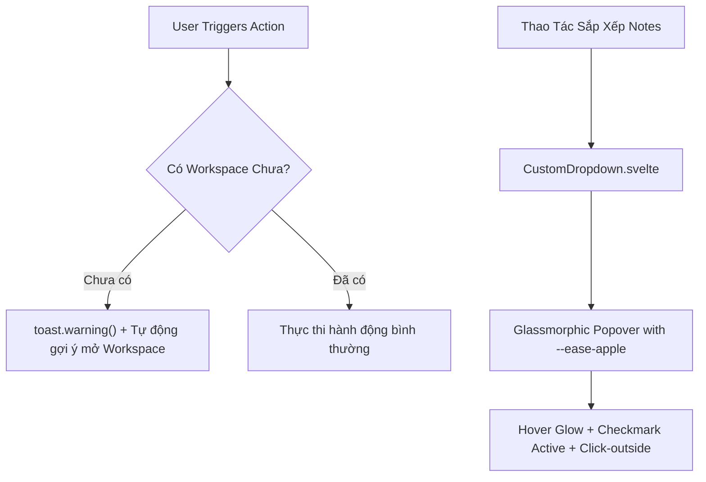

# Kế Hoạch Đợt 2: Xóa Bỏ Native Alert & Kiến Tạo Custom Glassmorphic Controls

> **Mục tiêu:** Loại bỏ hoàn toàn hộp thoại `alert()` mặc định của trình duyệt để chuyển sang hệ thống Sonner Toast trang nhã; Thay thế thẻ HTML `<select>` mặc định bằng Component Custom Dropdown kính mờ cao cấp chuẩn Apple Design & Emil Kowalski.

---

## 1. Phân Tích Hiện Trạng & Vấn Đề (Problem Statement)

### 1.1. Native Browser Alert (`alert()`)
- **Vị trí phát hiện:** [`frontend/src/lib/stores/vaultStore.ts`](file:///d:/Tu-hoc/project/MDVault/frontend/src/lib/stores/vaultStore.ts#L89)
  ```ts
  if (!currentWs && get(folders).length === 0) {
    alert('Vui lòng mở Workspace trước khi tạo ghi chú!')
    return
  }
  ```
- **Tác hại UX:** 
  - Khóa toàn bộ luồng tương tác của trình duyệt/ứng dụng (blocking UI).
  - Giao diện hộp thoại màu trắng phẳng thô kệch do Chromium/WebView2 sinh ra, làm vỡ tính thẩm mỹ cao cấp của MDVault.
  - Không có tính liên kết hành động (người dùng bấm OK xong vẫn phải tự đi tìm nút Open Vault).

### 1.2. Native HTML `<select>` Dropdown
- **Vị trí phát hiện:** [`frontend/src/components/note/NotesList.svelte`](file:///d:/Tu-hoc/project/MDVault/frontend/src/components/note/NotesList.svelte#L72-L80)
- **Tác hại UX:**
  - Menu bung ra là cửa sổ popup gốc của hệ điều hành Windows/Edge với nền trắng phẳng, thanh chọn màu xanh dương thô cứng.
  - Hoàn toàn không ăn nhập với ngôn ngữ thiết kế Glassmorphism, Dual Theme (Dark/Light mode) và typography của ứng dụng.

---

## 2. Kiến Trúc & Thiết Kế Giải Pháp (Architecture & Design)



### 2.1. Chuẩn Hóa Thông Báo (Zero Alert Protocol)
- Thay thế toàn bộ `alert()` bằng `toast.warning()` và `toast.error()` từ [`toastStore.ts`](file:///d:/Tu-hoc/project/MDVault/frontend/src/lib/stores/toastStore.ts).
- Khi người dùng cố tạo note khi chưa mở Workspace:
  - Bắn toast cảnh báo: *"Chưa mở Workspace - Vui lòng chọn hoặc tạo thư mục Vault trước khi thêm ghi chú"*.
  - Tự động kích hoạt luồng chọn Workspace `openWorkspaceDialog()` nếu người dùng mong muốn hoặc dẫn đường mượt mà.

### 2.2. Custom Glassmorphic Dropdown Component (`CustomDropdown.svelte`)
- **Vị trí:** `frontend/src/components/ui/CustomDropdown.svelte`
- **Nguyên lý thiết kế (`apple-design` & `emil-design-eng`):**
  - **Trigger Button:** Nhãn giá trị hiện tại, icon điều hướng, Chevron indicator xoay $180^\circ$ khi mở bằng `--ease-apple`. Phản hồi xúc giác `:active scale(0.97)`.
  - **Menu Popover:** 
    - Hiệu ứng kính mờ nhiều lớp `backdrop-blur-xl bg-[var(--bg-surface-elevated)]/95 border border-[var(--border-subtle)] shadow-[var(--shadow-glass)]`.
    - Xuất hiện từ điểm neo (origin-aware) với animation `scale(0.95) opacity-0` $\rightarrow$ `scale(1) opacity-1` trong 120ms.
    - Dấu tích `Check` cho mục đang chọn.
    - Xử lý đóng khi click ra ngoài (`clickOutside` action) và khi nhấn `Escape`.
    - Hỗ trợ phím mũi tên `ArrowUp` / `ArrowDown` và `Enter`.

---

## 3. Lộ Trình Triển Khai (Phased Tasks)

- **Task 1:** Triệt tiêu hoàn toàn `alert()` trong `vaultStore.ts` & kết nối cảnh báo qua Sonner Toast.
- **Task 2:** Xây dựng Component `frontend/src/components/ui/CustomDropdown.svelte` chuẩn Glassmorphism & Apple Design.
- **Task 3:** Tích hợp `CustomDropdown.svelte` vào bộ chọn sắp xếp `NotesList.svelte`.
- **Task 4:** Kiểm thử toàn diện (`npm run check`, `npm run build`), nghiệm thu trực quan và ghi nhận tài liệu.
